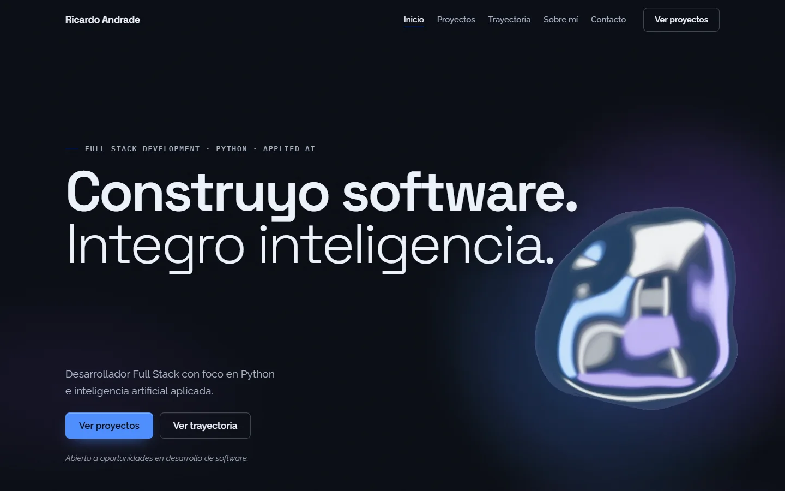

# Ricardo Andrade — Portafolio

Portafolio profesional de **Ricardo Andrade**, desarrollador Full Stack con foco en Python e inteligencia artificial aplicada.



## Qué incluye

- **Inicio** con una metaforma 3D en tiempo real (Three.js) que se deforma lentamente y se agita al pasar el cursor.
- **Proyectos destacados**: LicitAI y Flux, con capturas reales de cada aplicación.
- **Capacidades**, **experiencia**, **perfil**, **formación** y **contacto**, con el CV descargable.

## Stack

| Área | Tecnología |
| --- | --- |
| Interfaz | React 19 · TypeScript |
| Routing y build | React Router 8 (modo framework, sin servidor) · Vite 8 |
| 3D | three.js · React Three Fiber |
| Estilos | CSS Modules con tokens de diseño centralizados |
| Tipografías | Space Grotesk, Raleway e IBM Plex Mono (Fontsource, servidas desde el propio sitio) |
| Calidad | ESLint (con `jsx-a11y`) · Prettier · `tsc` |
| Despliegue | Vercel (sitio estático) |

## Decisiones técnicas

- **Estático y pre-renderizado.** `ssr: false` con `prerender: ["/"]`: la página principal se genera como HTML en el build, sin backend.
- **Contenido separado de la interfaz.** Los textos y datos viven tipados en `app/content/`; los componentes no contienen copy.
- **3D con coste controlado.** La escena se carga en un chunk diferido y solo en el cliente. En pantallas pequeñas, con ahorro de datos, sin WebGL 2 o si la escena falla, se muestra un render estático. La animación se pausa fuera de pantalla.
- **Accesibilidad.** HTML semántico, enlace para saltar al contenido, foco visible, menú móvil operable con teclado (Escape lo cierra y devuelve el foco), y respeto por `prefers-reduced-motion`, `forced-colors` y `prefers-contrast`.
- **Responsive por composición, no solo por escala.** El hero, el menú y las secciones cambian de disposición entre teléfono, tablet y escritorio.

## Estructura

```text
app/
├── assets/          Imágenes procesadas (render del 3D, retrato, portadas)
├── components/
│   ├── hero/        Hero, escena 3D, shader y render estático
│   ├── home/        Secciones de la página principal
│   ├── layout/      Cabecera, pie y enlace de salto
│   └── ui/          Componentes base (botones, enlaces, tarjetas, etiquetas)
├── content/         Contenido tipado (fuente única de textos y datos)
├── lib/             SEO y utilidades
├── routes/          Página principal y 404
└── styles/          Tokens de diseño y estilos globales
public/              Favicons y CV en PDF
docs/                Copy aprobado y material de diseño
```

## Desarrollo local

Requisitos: Node.js 20.19 o superior.

```bash
npm install
npm run dev        # servidor de desarrollo
```

| Script | Uso |
| --- | --- |
| `npm run dev` | Servidor de desarrollo |
| `npm run build` | Build de producción en `build/client` |
| `npm run preview` | Sirve el build de producción en local |
| `npm run typecheck` | Genera los tipos de rutas y ejecuta `tsc` |
| `npm run lint` | ESLint |
| `npm run format` / `format:check` | Prettier |

## Despliegue

`vercel.json` define el build (`npm run build`), la carpeta de salida (`build/client`) y la redirección de rutas no pre-renderizadas al fallback de la SPA.

## Documentación del proyecto

- [`SPEC.md`](SPEC.md): alcance y requisitos.
- [`ROADMAP.md`](ROADMAP.md): fases y criterios de terminado.
- [`DESIGN-SYSTEM.md`](DESIGN-SYSTEM.md): dirección visual, tokens y reglas de interfaz.
- [`docs/COPY-HOME-FINAL.md`](docs/COPY-HOME-FINAL.md): textos aprobados de la página principal.

## Contacto

- Correo: [randradev.dev@gmail.com](mailto:randradev.dev@gmail.com)
- GitHub: [@randradev](https://github.com/randradev)
- LinkedIn: [ricardo-andrade-valderrama](https://www.linkedin.com/in/ricardo-andrade-valderrama/)
