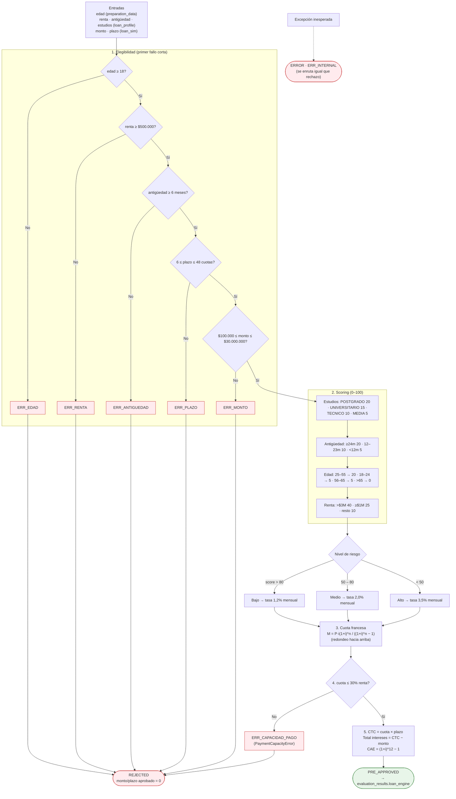
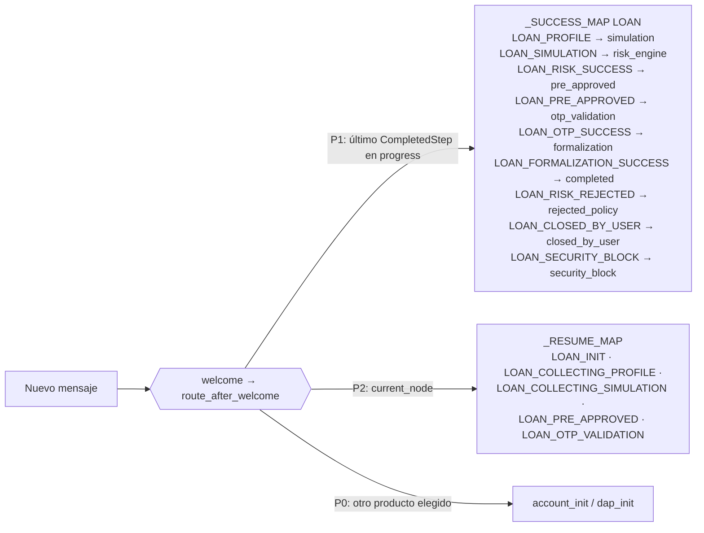

# FLUX — Flujo de Crédito de Consumo

> Basado en el código actual: `backend/app/graph/nodes/credit.py`, `backend/app/modules/credit_eng.py`,
> `backend/app/graph/edges.py` y `backend/app/modules/security.py`.

---

## 1. Flujo completo (vista de negocio)

```mermaid
flowchart TD
    START(["Usuario elige 'Crédito de Consumo'<br/>o el intent_router detecta LOAN"]) --> INIT

    INIT["<b>loan_init</b><br/>Saludo de bienvenida (sin LLM)<br/>semáforo: node SUCCESS · engine PENDING"]
    INIT --> PROF

    %% ── Perfil ──
    PROF["<b>loan_collecting_profile</b><br/>Pide: renta líquida · antigüedad laboral (meses)<br/>· nivel de estudios"]
    PROF --> PROF_EXT["Llamada A — extracción LLM<br/>LoanProfileExtraction<br/>(ignora centinelas: 0, -1, DESCONOCIDO)"]
    PROF_EXT --> PROF_Q{"¿intención =<br/>PREGUNTA?"}
    PROF_Q -- Sí --> PROF_RAG["Responde con consultor RAG<br/>(se queda en el nodo)"] --> WAIT1(["⏸ Espera turno"])
    PROF_Q -- No --> PROF_C{"¿Faltan campos?<br/>renta ≤ 0 · antigüedad < 0 ·<br/>estudios ∉ POSTGRADO/UNIVERSITARIO/<br/>TECNICO/MEDIA"}
    PROF_C -- Sí --> PROF_GEN["Llamada B — generación LLM<br/>re-pregunta lo que falta"] --> WAIT1
    PROF_C -- No --> PROF_OK["progress.loan.profile_completed = true<br/>just_completed_step = LOAN_PROFILE"]
    PROF_OK -->|salto intra-turno| SIM

    %% ── Simulación ──
    SIM["<b>loan_collecting_simulation</b><br/>Pide: monto solicitado · plazo (cuotas)"]
    SIM --> SIM_J{"¿Viene de salto<br/>intra-turno?"}
    SIM_J -- Sí --> SIM_C
    SIM_J -- No --> SIM_EXT["Llamada A — extracción LLM<br/>LoanSimExtraction"]
    SIM_EXT --> SIM_Q{"¿PREGUNTA?"}
    SIM_Q -- Sí --> SIM_RAG["Responde con consultor RAG"] --> WAIT2(["⏸ Espera turno"])
    SIM_Q -- No --> SIM_C{"¿Faltan campos?<br/>monto ≤ 0 · plazo ≤ 0"}
    SIM_C -- Sí --> SIM_GEN["Llamada B — pide monto/plazo"] --> WAIT2
    SIM_C -- No --> SIM_OK["progress.loan.simulation_completed = true<br/>just_completed_step = LOAN_SIMULATION"]
    SIM_OK -->|salto intra-turno| ENG

    %% ── Motor ──
    ENG[["<b>loan_risk_engine</b><br/>CreditEngine.run()<br/>(ver sección 2)"]]
    ENG --> ENG_R{"status_proceso"}
    ENG_R -- PRE_APPROVED --> ENG_OK["just_completed_step = LOAN_RISK_SUCCESS<br/>progress.risk_engine_completed = true"]
    ENG_R -- "REJECTED / ERROR" --> ENG_KO["just_completed_step = LOAN_RISK_REJECTED"]
    ENG_OK --> PRE
    ENG_KO --> REJ

    %% ── Oferta ──
    PRE["<b>loan_pre_approved</b><br/>Tarjeta de transparencia: monto · plazo · tasa ·<br/>cuota · CTC · total intereses · CAE · riesgo"]
    PRE --> PRE_J{"¿Viene del motor<br/>(intra-turno)?"}
    PRE_J -- Sí --> PRE_SHOW["Llamada B — presenta la oferta<br/>+ transparency_data.loan"] --> WAIT3(["⏸ Espera turno"])
    PRE_J -- No --> PRE_EXT["Llamada A — LoanDecisionExtraction<br/>+ respaldo por keywords<br/>(ACEPTO/SI · RECHAZO/NO)"]
    PRE_EXT --> PRE_D{"decisión"}
    PRE_D -- PREGUNTA --> PRE_RAG["Consultor RAG<br/>(se mantiene la oferta)"] --> WAIT3
    PRE_D -- "OTRO / PENDING" --> PRE_SHOW
    PRE_D -- ACCEPTED --> PRE_OK["offer_data.loan: ACCEPTED + timestamp<br/>(foto congelada de la oferta)<br/>just_completed_step = LOAN_PRE_APPROVED"]
    PRE_D -- REJECTED --> PRE_KO["just_completed_step = LOAN_CLOSED_BY_USER"]
    PRE_OK --> OTP
    PRE_KO --> CLOSED

    %% ── OTP ──
    OTP["<b>loan_otp_validation</b>"]
    OTP --> OTP_J{"¿Primer ingreso<br/>y sin OTP generado?"}
    OTP_J -- Sí --> OTP_SEND["security.generate_otp() (6 dígitos)<br/>send_otp_email() vía Resend<br/>(fallback MOCK en consola)<br/>otp_attempts = 0"] --> WAIT4(["⏸ Espera código"])
    OTP_J -- No --> OTP_IN{"¿Mensaje contiene<br/>un código?"}
    OTP_IN -- No --> OTP_Q{"¿PREGUNTA?"}
    OTP_Q -- Sí --> OTP_RAG["Consultor RAG"] --> WAIT4
    OTP_Q -- No --> OTP_GEN["Llamada B — recuerda ingresar código"] --> WAIT4
    OTP_IN -- Sí --> OTP_V{"validate_otp()"}
    OTP_V -- Correcto --> OTP_OK["progress.otp_validated = true<br/>just_completed_step = LOAN_OTP_SUCCESS"]
    OTP_V -- Incorrecto --> OTP_ATT["otp_attempts += 1"]
    OTP_ATT --> OTP_MAX{"¿intentos ≥ 3?"}
    OTP_MAX -- No --> OTP_GEN
    OTP_MAX -- Sí --> OTP_BLK["auth_control.security_blocked = true<br/>just_completed_step = LOAN_SECURITY_BLOCK"]
    OTP_OK --> FORM
    OTP_BLK --> BLOCK

    %% ── Formalización ──
    FORM[["<b>loan_formalization</b><br/>PDFFactory.create_pdf('CREDITO_CONSUMO')<br/>+ hash SHA-256"]]
    FORM --> FORM_UP["upload_contract_to_storage()<br/>bucket 'contracts'"]
    FORM_UP --> FORM_R{"¿URL pública<br/>obtenida?"}
    FORM_R -- Sí --> FORM_OK["contract_status = SIGNED_AND_STAMPED<br/>just_completed_step = LOAN_FORMALIZATION_SUCCESS"] --> DONE
    FORM_R -- "No / excepción" --> FORM_KO["contract_status = GENERATION_FAILED<br/>semáforo node FAILED"] --> STOP(["⏹ END (flujo detenido)"])

    %% ── Terminales ──
    DONE(["✅ <b>loan_completed</b><br/>flow_result: SUCCESS<br/>display_data: download_url · security_hash"])
    REJ(["❌ <b>loan_rejected_policy</b><br/>flow_result: REJECTED<br/>close_reason = motivo_rechazo"])
    CLOSED(["🚪 <b>loan_closed_by_user</b><br/>flow_result: CLOSED_BY_USER<br/>close_reason = USER_REJECTED_OFFER"])
    BLOCK(["🔒 <b>loan_security_block</b><br/>block_user_security(): users.user_status = BLOCKED_SECURITY<br/>flow_result: SECURITY_BLOCKED · OTP_LIMIT_EXCEEDED"])

    classDef term fill:#e8f5e9,stroke:#2e7d32;
    classDef bad fill:#ffebee,stroke:#c62828;
    classDef wait fill:#fff8e1,stroke:#f9a825;
    class DONE term;
    class REJ,CLOSED,BLOCK,STOP bad;
    class WAIT1,WAIT2,WAIT3,WAIT4 wait;
```

---

## 2. Motor de riesgo — `CreditEngine.run()`

---

## 3. Reanudación entre turnos

Cada nodo guarda en `session.current_node` dónde debe continuar la conversación. Al llegar el siguiente mensaje, `route_after_welcome` decide:

---

## 4. Hitos (`CompletedStep`) y semáforos

| Nodo | Hito emitido | `financial_applications` |
|---|---|---|
| `loan_init` | — | node `SUCCESS` · engine `PENDING` |
| `loan_collecting_profile` | `LOAN_PROFILE` | node `SUCCESS` · engine `PENDING` |
| `loan_collecting_simulation` | `LOAN_SIMULATION` | node `SUCCESS` · engine `PENDING` |
| `loan_risk_engine` | `LOAN_RISK_SUCCESS` / `LOAN_RISK_REJECTED` | engine `SUCCESS` (o `FAILED` si ERROR) |
| `loan_pre_approved` | `LOAN_PRE_APPROVED` / `LOAN_CLOSED_BY_USER` | node `SUCCESS` · engine `SUCCESS` |
| `loan_otp_validation` | `LOAN_OTP_SUCCESS` / `LOAN_SECURITY_BLOCK` | — |
| `loan_formalization` | `LOAN_FORMALIZATION_SUCCESS` | node `SUCCESS` / `FAILED` · documento generado |
| Terminales | — | `current_node_id` = nodo terminal |
