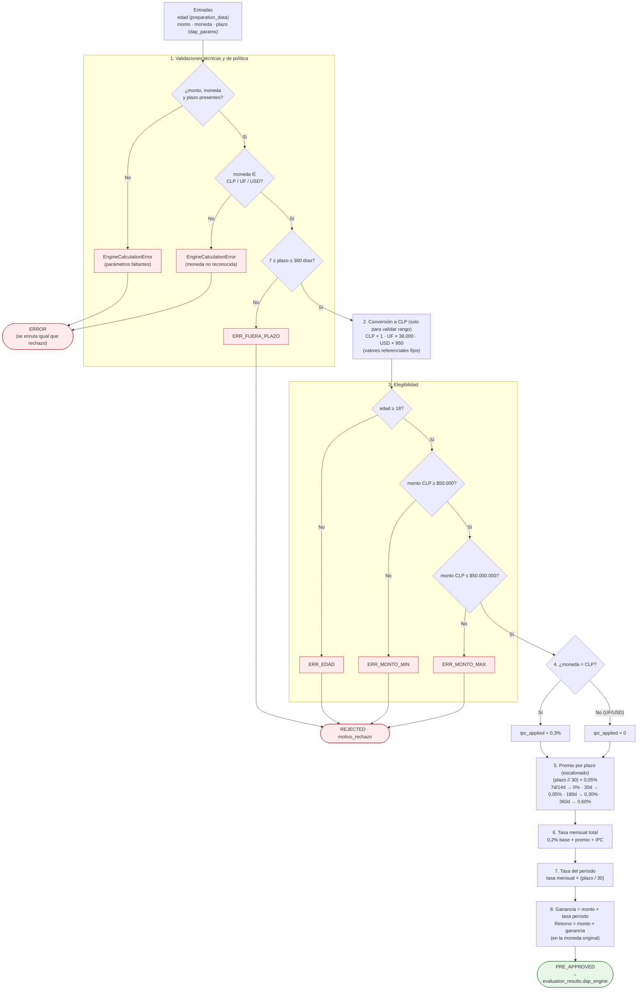
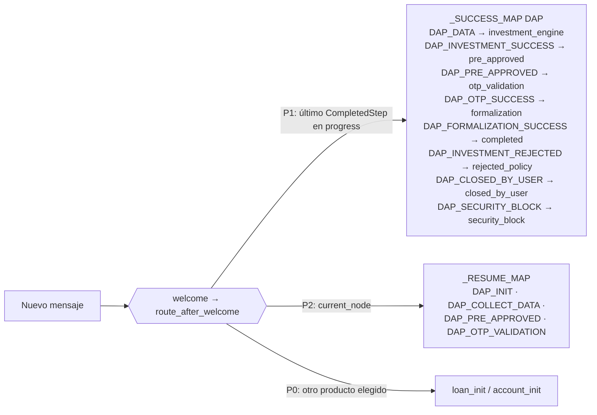

# FLUX — Flujo de Depósito a Plazo (DAP)

> Basado en el código actual: `backend/app/graph/nodes/deposit.py`, `backend/app/modules/dap_eng.py`,
> `backend/app/graph/edges.py` y `backend/app/modules/security.py`.

---

## 1. Flujo completo (vista de negocio)

```mermaid
flowchart TD
    START(["Usuario elige 'Depósito a Plazo'<br/>o el intent_router detecta DAP"]) --> INIT

    INIT["<b>dap_init</b><br/>Saludo de bienvenida (sin LLM)<br/>semáforo inicial"]
    INIT --> COL

    %% ── Recolección ──
    COL["<b>dap_collect_data</b><br/>Pide: monto · moneda (CLP / UF / USD) · plazo en días"]
    COL --> COL_E{"¿Mensaje vacío?"}
    COL_E -- Sí --> COL_GEN
    COL_E -- No --> COL_EXT["Llamada A — extracción LLM<br/>DapDataExtraction<br/>(ej. '1 mes' → 30 días · 'pesos' → CLP)<br/>ignora centinelas: 0, DESCONOCIDO, null"]
    COL_EXT --> COL_Q{"¿intención =<br/>PREGUNTA?"}
    COL_Q -- Sí --> COL_RAG["Responde con consultor RAG<br/>(se queda en el nodo)"] --> WAIT1(["⏸ Espera turno"])
    COL_Q -- No --> COL_C{"¿Faltan campos?<br/>monto ≤ 0 · plazo ≤ 0 ·<br/>moneda ∉ CLP/UF/USD"}
    COL_C -- Sí --> COL_GEN["Llamada B — generación LLM<br/>re-pregunta lo que falta"] --> WAIT1
    COL_C -- No --> COL_OK["progress.dap.data_completed = true<br/>just_completed_step = DAP_DATA"]
    COL_OK -->|salto intra-turno| ENG

    %% ── Motor ──
    ENG[["<b>dap_investment_engine</b><br/>DapEngine.run()<br/>(ver sección 2)"]]
    ENG --> ENG_R{"status_proceso"}
    ENG_R -- PRE_APPROVED --> ENG_OK["just_completed_step = DAP_INVESTMENT_SUCCESS<br/>progress.investment_engine_completed = true"]
    ENG_R -- "REJECTED / ERROR" --> ENG_KO["just_completed_step = DAP_INVESTMENT_REJECTED"]
    ENG_OK --> PRE
    ENG_KO --> REJ

    %% ── Oferta ──
    PRE["<b>dap_pre_approved</b><br/>Tarjeta de transparencia: monto · moneda · plazo ·<br/>tasa mensual (incl. premio) · tasa del período ·<br/>ganancia estimada · retorno total · conversión · IPC"]
    PRE --> PRE_J{"¿Viene del motor<br/>(intra-turno)?"}
    PRE_J -- Sí --> PRE_SHOW["Llamada B — presenta la oferta<br/>+ transparency_data.dap"] --> WAIT2(["⏸ Espera turno"])
    PRE_J -- No --> PRE_EXT["Llamada A — DapDecisionExtraction<br/>+ respaldo por keywords"]
    PRE_EXT --> PRE_D{"decisión"}
    PRE_D -- PREGUNTA --> PRE_RAG["Consultor RAG<br/>(se mantiene la oferta)"] --> WAIT2
    PRE_D -- "OTRO / PENDING" --> PRE_SHOW
    PRE_D -- ACCEPTED --> PRE_OK["offer_data.dap: ACCEPTED + timestamp<br/>just_completed_step = DAP_PRE_APPROVED"]
    PRE_D -- REJECTED --> PRE_KO["just_completed_step = DAP_CLOSED_BY_USER"]
    PRE_OK --> OTP
    PRE_KO --> CLOSED

    %% ── OTP ──
    OTP["<b>dap_otp_validation</b>"]
    OTP --> OTP_J{"¿Primer ingreso<br/>y sin OTP generado?"}
    OTP_J -- Sí --> OTP_SEND["security.generate_otp() (6 dígitos)<br/>send_otp_email() vía Resend<br/>(fallback MOCK en consola)<br/>otp_attempts = 0"] --> WAIT3(["⏸ Espera código"])
    OTP_J -- No --> OTP_IN{"¿Mensaje contiene<br/>un código?"}
    OTP_IN -- No --> OTP_Q{"¿PREGUNTA?"}
    OTP_Q -- Sí --> OTP_RAG["Consultor RAG"] --> WAIT3
    OTP_Q -- No --> OTP_GEN["Llamada B — recuerda ingresar código"] --> WAIT3
    OTP_IN -- Sí --> OTP_V{"validate_otp()"}
    OTP_V -- Correcto --> OTP_OK["progress.otp_validated = true<br/>just_completed_step = DAP_OTP_SUCCESS"]
    OTP_V -- Incorrecto --> OTP_ATT["otp_attempts += 1"]
    OTP_ATT --> OTP_MAX{"¿intentos ≥ 3?"}
    OTP_MAX -- No --> OTP_GEN
    OTP_MAX -- Sí --> OTP_BLK["auth_control.security_blocked = true<br/>just_completed_step = DAP_SECURITY_BLOCK"]
    OTP_OK --> FORM
    OTP_BLK --> BLOCK

    %% ── Formalización ──
    FORM[["<b>dap_formalization</b><br/>PDFFactory.create_pdf('DEPOSITO_A_PLAZO')<br/>+ hash SHA-256"]]
    FORM --> FORM_UP["upload_contract_to_storage()<br/>bucket 'contracts'"]
    FORM_UP --> FORM_R{"¿URL pública<br/>obtenida?"}
    FORM_R -- Sí --> FORM_OK["contract_status = SIGNED_AND_STAMPED<br/>just_completed_step = DAP_FORMALIZATION_SUCCESS"] --> DONE
    FORM_R -- "No / excepción" --> FORM_KO["contract_status = GENERATION_FAILED"] --> STOP(["⏹ END (flujo detenido)"])

    %% ── Terminales ──
    DONE(["✅ <b>dap_completed</b><br/>flow_result: SUCCESS<br/>display_data: download_url · security_hash"])
    REJ(["❌ <b>dap_rejected_policy</b><br/>flow_result: REJECTED<br/>close_reason = motivo_rechazo"])
    CLOSED(["🚪 <b>dap_closed_by_user</b><br/>flow_result: CLOSED_BY_USER<br/>close_reason = USER_REJECTED_OFFER"])
    BLOCK(["🔒 <b>dap_security_block</b><br/>block_user_security(): users.user_status = BLOCKED_SECURITY<br/>flow_result: SECURITY_BLOCKED · OTP_LIMIT_EXCEEDED"])

    classDef term fill:#e8f5e9,stroke:#2e7d32;
    classDef bad fill:#ffebee,stroke:#c62828;
    classDef wait fill:#fff8e1,stroke:#f9a825;
    class DONE term;
    class REJ,CLOSED,BLOCK,STOP bad;
    class WAIT1,WAIT2,WAIT3 wait;
```

---

## 2. Motor de inversión — `DapEngine.evaluate()`

> En `dap_eng.py` está definida la constante `PLAZOS_VALIDOS = {7, 14, 30, 180, 360}`, pero el motor no la usa: solo verifica el rango 7–360 días, así que se acepta cualquier plazo intermedio (por ejemplo, 90 días).

---

## 3. Reanudación entre turnos

---

## 4. Hitos (`CompletedStep`) por nodo

| Nodo | Hito emitido | Siguiente nodo |
|---|---|---|
| `dap_init` | — | `dap_collect_data` (mismo turno) |
| `dap_collect_data` | `DAP_DATA` | `dap_investment_engine` |
| `dap_investment_engine` | `DAP_INVESTMENT_SUCCESS` / `DAP_INVESTMENT_REJECTED` | `dap_pre_approved` / `dap_rejected_policy` |
| `dap_pre_approved` | `DAP_PRE_APPROVED` / `DAP_CLOSED_BY_USER` | `dap_otp_validation` / `dap_closed_by_user` |
| `dap_otp_validation` | `DAP_OTP_SUCCESS` / `DAP_SECURITY_BLOCK` | `dap_formalization` / `dap_security_block` |
| `dap_formalization` | `DAP_FORMALIZATION_SUCCESS` | `dap_completed` |

### Mensajes de rechazo al usuario

| Código | Origen |
|---|---|
| `ERR_EDAD` | edad < 18 |
| `ERR_MONTO_MIN` | monto equivalente en CLP < $50.000 |
| `ERR_MONTO_MAX` | monto equivalente en CLP > $50.000.000 |
| `ERR_FUERA_PLAZO` | plazo fuera de 7–360 días ("mínimo 7 días y máximo 1 año") |
