# FLUX — Arquitectura Actualizada

> Documento generado a partir del estado actual del repositorio (rama `feat/estabilizacion-frontend`, commit `f04004c`).
> Refleja el código tal como está, no el diseño original de `documentacion-gral/arquitectura.md`.

---

## 1. Vista general del sistema (contexto y contenedores)

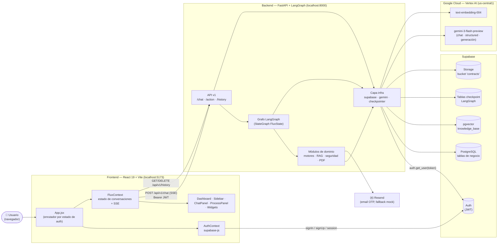

---

## 2. Arquitectura en capas del backend

```mermaid
flowchart TB
    subgraph L0["Punto de entrada"]
        MAIN["main.py<br/>FastAPI · CORS · WindowsSelectorEventLoopPolicy<br/>GET /health"]
        CFG["app/config.py<br/>Settings (pydantic-settings, .env)"]
    end

    subgraph L1["Capa API — app/api"]
        DEPS["deps.py<br/>get_current_user → get_verified_user<br/>(JWT Supabase + perfil en tabla users,<br/>403 si BLOCKED_SECURITY)"]
        CHAT["v1/chat.py<br/>POST /chat · POST /action<br/>stream_graph_response() → SSE<br/>_NODE_LABELS · build_node_transition_payload"]
        DOCS["v1/docs.py<br/>GET /history · GET /history/{id}<br/>DELETE /history/{id}"]
    end

    subgraph L2["Capa de Orquestación — app/graph"]
        WF["workflow.py<br/>build_graph() · get_active_graph()<br/>(singleton lazy, compile con checkpointer)"]
        EDG["edges.py<br/>route_after_* (P0–P4)<br/>_RESUME_MAP · _INTENT_MAP · _SUCCESS_MAP"]
        ST["state.py<br/>FluxState (9 namespaces)"]
        CONST["constants.py<br/>CompletedStep · ProductPrefix"]
        subgraph NODES["nodes/"]
            NCOM["common.py<br/>welcome · intent_router · general_response"]
            NCRE["credit.py<br/>11 nodos loan_*"]
            NACC["account.py<br/>10 nodos account_*"]
            NDAP["deposit.py<br/>10 nodos dap_*"]
            NSCH["schemas/<br/>Pydantic de extracción LLM"]
        end
    end

    subgraph L3["Capa de Dominio — app/modules"]
        CE["credit_eng.py<br/>CreditEngine: scoring, riesgo,<br/>cuota francesa, CAE, capacidad 30%"]
        AE["account_eng.py<br/>AccountEngine: elegibilidad,<br/>categoría START/MEDIUM/ADVANCE, línea"]
        DE["dap_eng.py<br/>DapEngine: conversión UF/USD,<br/>IPC, premio por plazo, retorno"]
        CONS["consultant.py<br/>RAG: embeddings → RPC<br/>match_knowledge_base → Gemini"]
        SEC["security.py<br/>generate/validate OTP, intentos,<br/>send_otp_email (Resend), SHA-256"]
        PDF["pdf_factory.py<br/>PDFFactory (ReportLab, SpaceGrotesk)<br/>contrato + hash SHA-256"]
        ECO["eco_service.py<br/>(vacío)"]
    end

    subgraph L4["Capa de Infraestructura — app/infra · app/utils"]
        ISB["supabase.py<br/>users · conversations · messages<br/>financial_applications (semáforos)<br/>storage · block_user_security"]
        IGEM["gemini_client.py<br/>get_chat_model · get_structured_model<br/>get_generation_model · get_embeddings_model"]
        ICK["checkpointer.py<br/>AsyncPostgresSaver + AsyncConnectionPool"]
        ITH["threading.py<br/>get_or_create_thread (propiedad user↔conv)<br/>get_langgraph_config"]
        IEMB["embeddings.py<br/>similarity_search (stub)"]
        LLMU["utils/llm_utils.py<br/>normalize_llm_response"]
    end

    MAIN --> CHAT & DOCS
    MAIN -.-> CFG
    CHAT --> DEPS
    DOCS --> DEPS
    CHAT --> ITH
    CHAT --> WF
    CHAT --> ISB
    DOCS --> ISB
    WF --> EDG & NODES
    WF --> ICK
    EDG --> CONST
    NODES --> ST
    NODES --> CONST
    NCRE --> CE
    NACC --> AE
    NDAP --> DE
    NCRE & NACC & NDAP --> CONS & SEC & PDF
    NODES --> IGEM
    NODES --> ISB
    NODES --> LLMU
    CONS --> IGEM
    CONS --> ISB
    IEMB --> IGEM
    DEPS --> ISB
    ITH --> ISB
```

---

## 3. Grafo de estados LangGraph (workflow completo)

Punto de entrada único: `welcome`. Cada ejecución del grafo corresponde a **un turno** del usuario; las aristas a `END` marcan los puntos donde el grafo se detiene a esperar el siguiente mensaje.

```mermaid
flowchart TD
    START((START)) --> welcome

    welcome{{"welcome<br/>route_after_welcome<br/>P0 cambio producto · P1 salto por éxito<br/>P2 reanudación · P3 intención · P4 router"}}

    welcome -->|P4 sin señales| intent_router
    welcome -->|"P0/P3 LOAN"| loan_init
    welcome -->|"P0/P3 ACCOUNT"| account_init
    welcome -->|"P0/P3 DAP"| dap_init
    welcome -.->|"P1/P2 reanudación<br/>(cualquier nodo del flujo)"| RESUME["nodos de recolección,<br/>oferta, OTP, motores,<br/>formalización y terminales"]

    intent_router["intent_router<br/>(LLM structured: IntentExtractionSchema)"]
    intent_router -->|LOAN| loan_init
    intent_router -->|ACCOUNT| account_init
    intent_router -->|DAP| dap_init
    intent_router -->|GENERAL| general_response
    general_response["general_response"] --> END1((END))

    %% ───────── CRÉDITO ─────────
    subgraph LOAN["💰 Crédito de Consumo"]
        loan_init["loan_init<br/>(sin LLM)"] --> loan_collecting_profile
        loan_collecting_profile["loan_collecting_profile<br/>renta · antigüedad · estudios"]
        loan_collecting_profile -->|LOAN_PROFILE| loan_collecting_simulation
        loan_collecting_simulation["loan_collecting_simulation<br/>monto · plazo"]
        loan_collecting_simulation -->|LOAN_SIMULATION| loan_risk_engine
        loan_risk_engine[["loan_risk_engine<br/>CreditEngine"]]
        loan_risk_engine -->|RISK_SUCCESS| loan_pre_approved
        loan_risk_engine -->|RISK_REJECTED| loan_rejected_policy
        loan_pre_approved["loan_pre_approved<br/>tarjeta de transparencia"]
        loan_pre_approved -->|acepta| loan_otp_validation
        loan_pre_approved -->|rechaza| loan_closed_by_user
        loan_otp_validation["loan_otp_validation<br/>máx. 3 intentos"]
        loan_otp_validation -->|OTP_SUCCESS| loan_formalization
        loan_otp_validation -->|3 fallos| loan_security_block
        loan_formalization[["loan_formalization<br/>PDF + SHA-256 + Storage"]]
        loan_formalization -->|FORMALIZATION_SUCCESS| loan_completed
        loan_completed(["loan_completed"])
        loan_rejected_policy(["loan_rejected_policy"])
        loan_security_block(["loan_security_block"])
        loan_closed_by_user(["loan_closed_by_user"])
    end

    %% ───────── CUENTA CORRIENTE ─────────
    subgraph ACC["🏦 Cuenta Corriente"]
        account_init["account_init<br/>(sin LLM)"] --> account_collecting_profile
        account_collecting_profile["account_collecting_profile<br/>renta · antigüedad · estudios"]
        account_collecting_profile -->|ACCOUNT_PROFILE| account_evaluation_engine
        account_evaluation_engine[["account_evaluation_engine<br/>AccountEngine"]]
        account_evaluation_engine -->|EVALUATION_SUCCESS| account_pre_approved
        account_evaluation_engine -->|EVALUATION_REJECTED| account_rejected_policy
        account_pre_approved["account_pre_approved"]
        account_pre_approved -->|acepta| account_otp_validation
        account_pre_approved -->|rechaza| account_closed_by_user
        account_otp_validation["account_otp_validation"]
        account_otp_validation -->|OTP_SUCCESS| account_formalization
        account_otp_validation -->|3 fallos| account_security_block
        account_formalization[["account_formalization"]]
        account_formalization -->|FORMALIZATION_SUCCESS| account_completed
        account_completed(["account_completed"])
        account_rejected_policy(["account_rejected_policy"])
        account_security_block(["account_security_block"])
        account_closed_by_user(["account_closed_by_user"])
    end

    %% ───────── DAP ─────────
    subgraph DAP["📈 Depósito a Plazo"]
        dap_init["dap_init<br/>(sin LLM)"] --> dap_collect_data
        dap_collect_data["dap_collect_data<br/>monto · moneda · plazo"]
        dap_collect_data -->|DAP_DATA| dap_investment_engine
        dap_investment_engine[["dap_investment_engine<br/>DapEngine"]]
        dap_investment_engine -->|INVESTMENT_SUCCESS| dap_pre_approved
        dap_investment_engine -->|INVESTMENT_REJECTED| dap_rejected_policy
        dap_pre_approved["dap_pre_approved"]
        dap_pre_approved -->|acepta| dap_otp_validation
        dap_pre_approved -->|rechaza| dap_closed_by_user
        dap_otp_validation["dap_otp_validation"]
        dap_otp_validation -->|OTP_SUCCESS| dap_formalization
        dap_otp_validation -->|3 fallos| dap_security_block
        dap_formalization[["dap_formalization"]]
        dap_formalization -->|FORMALIZATION_SUCCESS| dap_completed
        dap_completed(["dap_completed"])
        dap_rejected_policy(["dap_rejected_policy"])
        dap_security_block(["dap_security_block"])
        dap_closed_by_user(["dap_closed_by_user"])
    end

    WAIT((END<br/>espera turno))
    loan_collecting_profile & loan_collecting_simulation & loan_pre_approved & loan_otp_validation & loan_formalization -.->|incompleto / error| WAIT
    account_collecting_profile & account_pre_approved & account_otp_validation & account_formalization -.-> WAIT
    dap_collect_data & dap_pre_approved & dap_otp_validation & dap_formalization -.-> WAIT

    TERM((END))
    loan_completed & loan_rejected_policy & loan_security_block & loan_closed_by_user --> TERM
    account_completed & account_rejected_policy & account_security_block & account_closed_by_user --> TERM
    dap_completed & dap_rejected_policy & dap_security_block & dap_closed_by_user --> TERM
```

**Leyenda:** `[[ ]]` nodo de servicio automático (motor / formalización, sin espera de input) · `([ ])` nodo terminal · `{{ }}` nodo de ruteo.

### 3.1 Jerarquía de ruteo en `route_after_welcome`

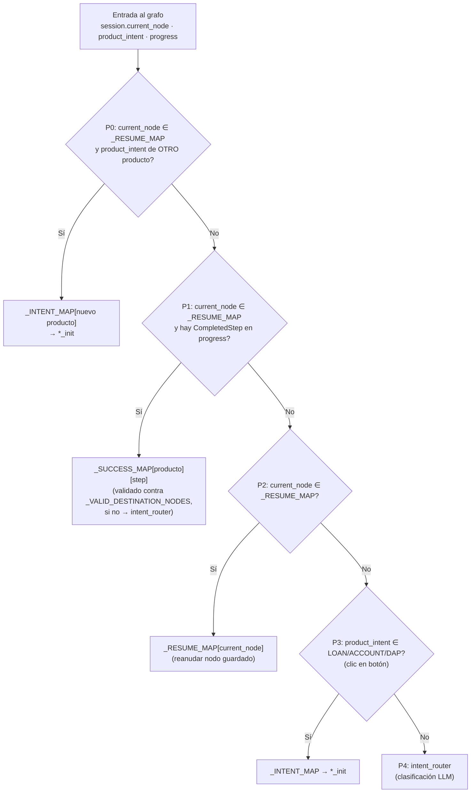

### 3.2 Patrón interno de un nodo de recolección / oferta / OTP

Todos los nodos conversacionales de los tres productos siguen el mismo patrón (desde los últimos commits, los nodos `*_init` ya **no** llaman al LLM).

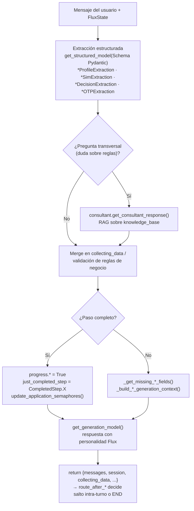

---

## 4. Secuencia de un turno de chat (end-to-end)

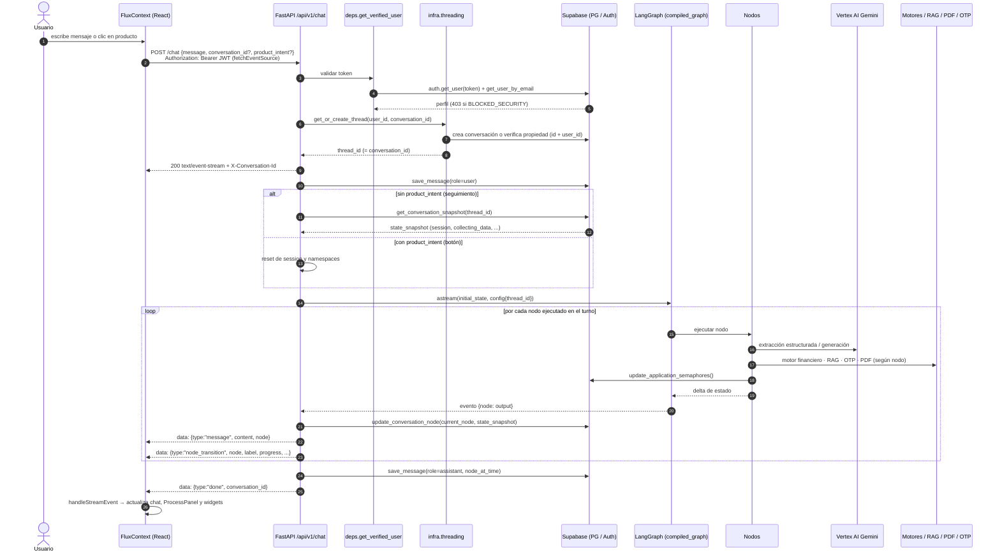

---

## 5. Estado global del grafo — `FluxState` (v2.x, namespaces)

```mermaid
classDiagram
    class FluxState {
        messages : list (add_messages)
        user_data : UserData
        session : SessionData
        preparation_data : PreparationData
        collecting_data : CollectingData
        evaluation_results : EvaluationResults
        offer_data : OfferData
        auth_control : AuthControl
        transparency_data : TransparencyData
        flow_result : FlowResult
    }
    class UserData {
        user_id, full_name, email, rut
        birth_date, user_status, user_category
    }
    class SessionData {
        conversation_id, application_id
        product_intent : LOAN|ACCOUNT|DAP|GENERAL
        current_node, previous_node
        is_transversal_active
        progress : ProgressData
        just_completed_step : volátil 1 turno
    }
    class ProgressData {
        loan : LoanProgress
        account : AccountProgress
        dap : DapProgress
    }
    class PreparationData {
        nombre, rut, mail, edad
    }
    class CollectingData {
        loan_profile : renta, antiguedad, estudios
        loan_sim : monto, plazo
        account_profile : renta, antiguedad, estudios
        dap_params : monto, moneda, plazo
    }
    class EvaluationResults {
        loan_engine : scoring, riesgo, tasa, cuota, CAE, CTC
        account_engine : categoría, upgrade, línea
        dap_engine : tasa periodo, ganancia, retorno
    }
    class OfferData {
        loan / account / dap
        pre_approval_status, timestamp_acceptance
        file_contrato_path, contract_status
        display_data : FinalDisplay
    }
    class AuthControl {
        security_blocked, service_error
        otp_attempts (0-3), otp_generated
        otp_user_input, block_timestamp
    }
    class TransparencyData {
        loan / account / dap (strings formateados)
    }
    class FlowResult {
        status_code : SUCCESS|REJECTED|CLOSED_BY_USER|SECURITY_BLOCKED
        close_reason, product_name, closed_at
    }
    FluxState *-- UserData
    FluxState *-- SessionData
    SessionData *-- ProgressData
    FluxState *-- PreparationData
    FluxState *-- CollectingData
    FluxState *-- EvaluationResults
    FluxState *-- OfferData
    FluxState *-- AuthControl
    FluxState *-- TransparencyData
    FluxState *-- FlowResult
```

---

## 6. Persistencia de estado (doble mecanismo)

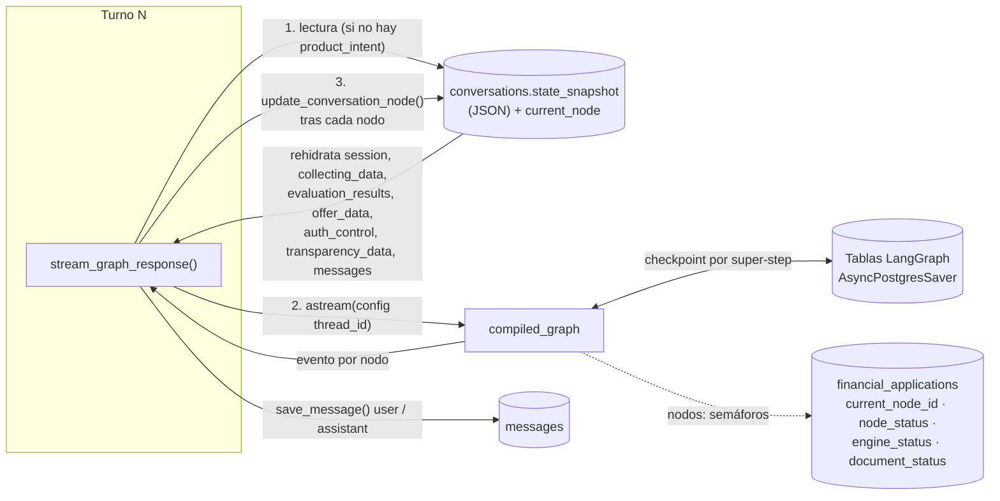

> El `state_snapshot` en `conversations` es la fuente que el endpoint usa para rehidratar al grafo en cada turno; el checkpointer de LangGraph se mantiene compilado en paralelo con el mismo `thread_id`.

---

## 7. Modelo de datos (Supabase / PostgreSQL — `backend/migrations`)

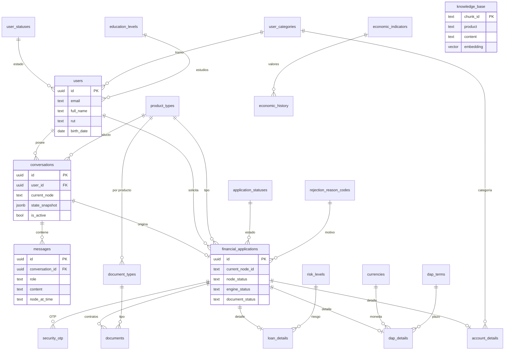

> `knowledge_base` y la función RPC `match_knowledge_base` (pgvector) no están en `migrations/`; se pueblan con `backend/scripts/ingest.py` a partir de `documentacion-gral/estrategia-chunking.md`.

### 7.1 Pipeline RAG

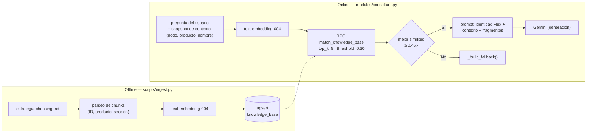

### 7.2 Formalización y seguridad (OTP → contrato)

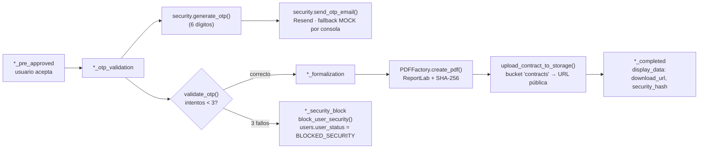

---

## 8. Arquitectura del frontend

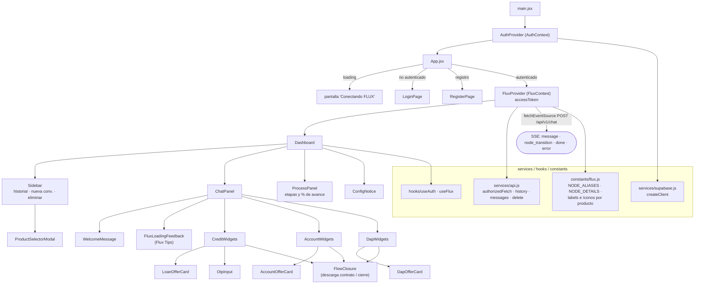

**Acciones de usuario desde widgets** → todas viajan como mensajes de texto por `sendMessage()` → `POST /api/v1/chat`:
- Aceptar / rechazar oferta: `"Acepto la oferta de crédito"` / `"Rechazo la oferta"`.
- OTP: el código ingresado en `OtpInput`.

---