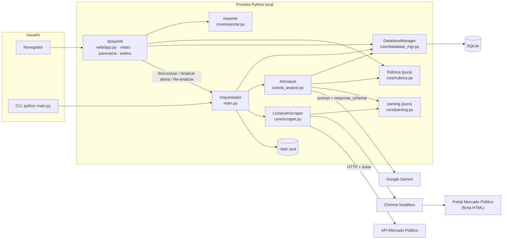

# LicitAI: arquitectura actual

Arquitectura del prototipo en `main`, commit `ca854c1` (22/10/2026). Es una aplicación **local, monousuario y en un solo proceso**: Streamlit, SQLite, Selenium y Gemini. El flujo detallado está en `licitai-processing-flow.md` y el score en `licitai-scoring-model.md`.

---

## 1. Resumen

| Aspecto | Estado actual |
|---|---|
| Tipo | Prototipo / MVP local para una sola empresa (perfil único, `CHECK (id = 1)`) |
| Lenguaje | Python 3.11+ |
| UI | Streamlit 1.54 con navegación superior y tema «editorial claro» (CSS propio, fuentes Inter y Newsreader locales) |
| Persistencia | SQLite (`data/mp_database.db`) mediante un DAO propio, sin ORM |
| Fuentes de datos | API pública de Mercado Público (listado diario) + ficha web leída con Selenium (Chrome headless) |
| IA | Google Gemini (`gemini-3-flash-preview` por defecto) mediante `google-generativeai==0.8.6`, con salida JSON estructurada |
| Gráficos | Altair 6 |
| Pruebas | pytest, 257 pruebas recolectadas (unitarias, de pipeline con dobles y de UI con `streamlit.testing.AppTest`) |
| Despliegue | Ninguno: se ejecuta en la máquina del usuario (`run_app.bat` o `python -m streamlit run web/app.py`) |

---

## 2. Diagrama de componentes



La UI llama al orquestador **de forma síncrona**, en el mismo proceso: no hay cola de trabajos, worker ni API HTTP intermedia.

---

## 3. Módulos y responsabilidades

### Núcleo (`core/`)
| Módulo | Responsabilidad | Elementos clave |
|---|---|---|
| `config.py` | Variables de entorno (`.env` en la raíz), límites del pipeline, modelo de Gemini, escala histórica 1–10 y logging (consola + archivo opcional) | `ruta_db`, `configurar_logging`, `MAX_PROCESAR`, `MAX_INTENTOS`, `IA_MAX_CHARS`, `GEMINI_MODEL` |
| `rubrica.py` | Fuente única de la rúbrica: criterios, pesos, escala, rangos, cálculo del score y lectura del resultado guardado. Sin red ni BD | `RUBRICA_VERSION`, `CRITERIOS`, `calcular`, `resultado_guardado`, `texto_resultado` |
| `parsing.py` | Funciones puras: keywords, fechas, metadatos de la ficha, versión del perfil, parseo y validación del JSON de la IA | `coincide_keywords`, `extraer_metadatos_ficha`, `version_perfil`, `parsear_respuesta_ia`, `validar_analisis`, `cargar_analisis_guardado` |
| `scraper.py` | Descubrimiento con la API, filtro por estado, keywords y cierre, y extracción de la ficha con Selenium | `LicitacionScraper`, `DriverNoDisponible`, `esperar_texto_estable` |
| `ai_analyst.py` | Prompt con la rúbrica, esquema de salida estructurada, llamada a Gemini, validación, cálculo y persistencia del análisis | `AIAnalyst`, `esquema_respuesta`, `PROMPT_VERSION`, `AnalisisFallido`, `CuotaAgotada` |
| `database_mgr.py` | DAO SQLite: esquema, migración aditiva, cola, fallos, análisis con historial, respuestas rechazadas, evaluaciones, ejecuciones y notas | `DatabaseManager`, `obtener_cola_procesamiento`, `registrar_fallo`, `guardar_analisis_ia` |
| `exportar.py` | Exportación a JSON/CSV con un formato estable, independiente del esquema | `a_json`, `a_csv`, `registro_exportable` |
| `migrar_datos.py` | Corrección de bases antiguas, con respaldo previo | `migrar`, `calcular_cambios`, `crear_respaldo` |

### Orquestación
| Módulo | Responsabilidad | Elementos clave |
|---|---|---|
| `main.py` | Bloqueo de ejecución, fases del pipeline, procesamiento de una licitación, análisis a pedido, re-análisis en lote y resumen | `ejecutar_pipeline`, `procesar_licitacion`, `analizar_ahora`, `reanalizar_lote`, `bloqueo_pipeline`, `describir_resumen` |

### Interfaz (`web/`)
| Módulo | Responsabilidad |
|---|---|
| `app.py` | Punto de entrada: configuración de la página, CSS, logo, navegación superior y pie |
| `paginas/*.py` | Un archivo de 5 líneas por página, necesario para probarlas con `AppTest.switch_page` |
| `vistas.py` | Helpers puros de presentación, HTML escapado, tarjetas, desglose de la rúbrica, formularios de evaluación y las funciones `pagina_*` |
| `panorama.py` | Preparación de datos y gráficos Altair (embudo, calendario de cierres, riesgo de pago, histograma del score, calibración), más un conteo de los análisis sin score comparable |
| `estilos.py` | CSS del tema; depende de los `data-testid` de Streamlit 1.54 |

**Páginas:** Oportunidades (por defecto) · Favoritas · Archivo · En proceso (cola, errores, «Analizar ahora», «Reintentar») · Panorama (gráficos y descarga CSV/JSON) · Perfil (keywords, descripción de la empresa e impacto de los cambios).

---

## 4. Dependencias entre capas

```
web/  ──►  main.py  ──►  core/scraper.py ─┐
  │                 └──►  core/ai_analyst.py ─┼──►  core/parsing.py  ──►  core/rubrica.py  ──►  core/config.py
  │                                        └──►  core/database_mgr.py
  └──►  core/rubrica.py, core/database_mgr.py, core/exportar.py
```

- `rubrica.py` y `parsing.py` no tienen efectos secundarios, así que se prueban de forma determinista.
- `AIAnalyst` y `LicitacionScraper` reciben el `DatabaseManager` por inyección. `ejecutar_pipeline` acepta dobles de `db`, `scraper` y `analyst`, y `AIAnalyst` acepta un `modelo` falso, lo que permite probar el pipeline sin red.

---

## 5. Modelo de datos (SQLite)

| Tabla | Propósito | Notas |
|---|---|---|
| `perfil_usuario` | Perfil único: keywords positivas y negativas, descripción de la empresa (`bio_estrategica`); `regiones` está reservada y no se usa | `CHECK (id = 1)` |
| `licitaciones` | Registro central: datos de la fuente, texto de la ficha, estado y reintentos, análisis vigente, score de la rúbrica, trazabilidad, notas, checklist y evaluación humana | PK `id_externo`; columnas nuevas con migración aditiva (`ALTER TABLE … ADD COLUMN`) |
| `analisis_historial` | Copia de cada análisis reemplazado, con su evaluación humana | Solo inserción; se escribe en la misma transacción que el nuevo análisis |
| `respuestas_fallidas` | Texto crudo de las respuestas de IA rechazadas por la validación (hasta 20 000 caracteres), con modelo, versión del prompt y error | Solo inserción; permite diagnosticar sin repetir la llamada |
| `ejecuciones` | Una fila por sincronización: listado, relevantes, registradas, analizadas, fallidas y motivos de parada | Alimenta el embudo de Panorama |

Columnas destacadas de `licitaciones`:
- **Gestión:** `estado` (`pendiente` · `extraido` · `analizado` · `favorita` · `archivada` · `error`), `intentos`, `ultimo_error`.
- **Fuente:** `titulo`, `organismo`, `fecha_cierre`, `fecha_publicacion`, `region`, `reclamos_pago_n`, `link`, `descripcion_pro`, `ficha_fecha`.
- **Análisis:** `analisis_ia_json`, `score_idoneidad`, `score_estado`, `score_cobertura`, `rubrica_version`, `motivo_archivo`, `reclamo_pago` (interpretación de la IA, no verificada).
- **Trazabilidad:** `analisis_modelo`, `analisis_prompt_version`, `analisis_perfil_version`, `analisis_fecha`.
- **Evaluación humana:** `eval_score` (`acertado` · `muy_alto` · `muy_bajo`), `eval_postularia` (`si` · `tal_vez` · `no`), `eval_comentario`, `eval_fecha`.
- **Histórico:** `score_ia` (escala 1–10, solo para análisis anteriores a la rúbrica).

Reglas de integridad aplicadas en el código:
- Los datos de la ficha (fuente) tienen prioridad. La IA solo rellena el título o el organismo si están vacíos o son un marcador de posición.
- Re-analizar nunca borra: el análisis anterior pasa al historial.
- Las favoritas y archivadas conservan su estado al re-analizarse.

---

## 6. Integraciones externas

| Servicio | Uso | Credencial | Fallo |
|---|---|---|---|
| API Mercado Público (`licitaciones.json?fecha=`) | Listado diario de licitaciones | `MP_TICKET` | Se registra en `error_descubrimiento` y se sigue con la cola existente |
| Portal Mercado Público | Ficha completa de cada licitación (Selenium + Chrome headless, driver con webdriver-manager) | — | Fallo de extracción (consume intento); si Chrome no arranca, se detiene sin consumir intentos |
| Google Gemini | Análisis estructurado de la ficha frente al perfil | `GEMINI_API_KEY` | Cuota: se detiene sin consumir intentos. Otro error o respuesta inválida: consume intento y la respuesta queda en `respuestas_fallidas` |

---

## 7. Configuración

Obligatorias en `.env`: `MP_TICKET`, `GEMINI_API_KEY`. Opcionales (con su valor por defecto): `DATABASE_PATH` (`data/mp_database.db`), `GEMINI_MODEL`, `LICITAI_MAX_PROCESAR` (5), `LICITAI_MAX_INTENTOS` (3), `LICITAI_HEADLESS` (true), `LICITAI_IA_MAX_CHARS` (40000), `LICITAI_HTTP_TIMEOUT` (30), `LICITAI_PAGE_TIMEOUT` (60), `LICITAI_PAUSA_SEGUNDOS` (5), `LICITAI_ESPERA_TEXTO` (15), `LICITAI_BLOQUEO_MAX_MINUTOS` (120), `LICITAI_LOG_FILE`.

Las rutas relativas se resuelven contra la raíz del proyecto, así que el comportamiento no depende del directorio de trabajo.

---

## 8. Versionado de lo que afecta al resultado

| Elemento | Dónde | Valor vigente |
|---|---|---|
| Rúbrica | `core/rubrica.py: RUBRICA_VERSION` | `v1.1` |
| Prompt y configuración del modelo | `core/ai_analyst.py: PROMPT_VERSION` | `2026-10-21.3` |
| Perfil | `parsing.version_perfil`: SHA-1 (8 caracteres) de las keywords normalizadas y la descripción | Calculado |

Con estas versiones, la UI marca los análisis hechos con un perfil anterior o con la rúbrica anterior, y ofrece re-analizarlos.

---

## 9. Pruebas

`venv/Scripts/python.exe -m pytest` → 257 pruebas recolectadas en `tests/`:
`test_rubrica`, `test_parsing`, `test_ai`, `test_pipeline`, `test_database`, `test_migracion`, `test_perfil_version`, `test_panorama_exportar`, `test_infraestructura` y `test_ui` (AppTest).
Las pruebas no llaman a la red: Gemini, Selenium y la API se sustituyen por dobles. Por eso **no verifican** el comportamiento real del portal ni la calidad de las respuestas del modelo.

---

## 10. Limitaciones de la arquitectura actual

- **Monousuario y local:** un solo perfil, sin autenticación ni multiempresa.
- **Ejecución síncrona en el proceso de Streamlit:** una sincronización bloquea la sesión que la inició. La concurrencia se controla solo con un archivo `.lock`.
- **SQLite en un archivo local:** adecuado para el prototipo, pero no para acceso concurrente de varios usuarios.
- **Scraping frágil:** depende de IDs y de la estructura HTML del portal, y no lee las bases en PDF.
- **SDK de Gemini `google-generativeai` 0.8.6:** se mantiene a propósito en el prototipo; su migración no está planificada aquí.
- **Sin planificador incluido:** la sincronización periódica depende de una tarea externa.
- **CSS acoplado a Streamlit 1.54** (selectores `data-testid`): una actualización de Streamlit puede romper estilos.
- La arquitectura de una eventual V2 aún **no está decidida**. Las propuestas viven en `LICITAI_PROJECT_DOSSIER.md` (§17–§19) y no forman parte de este documento.
