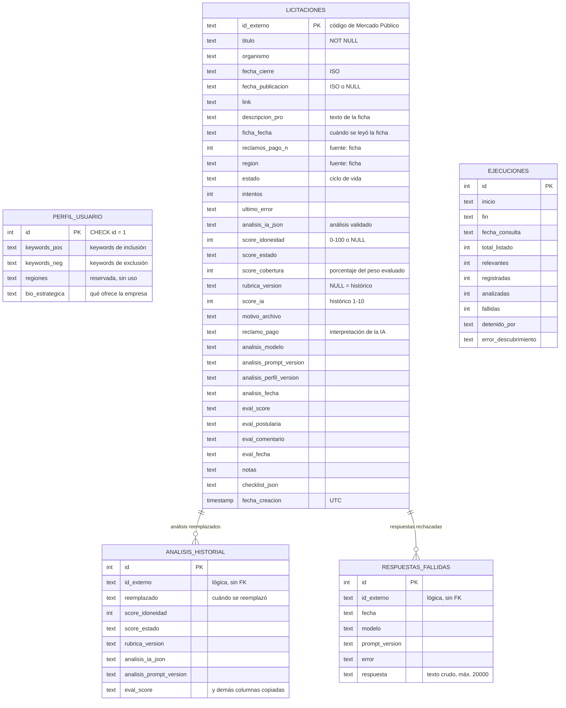
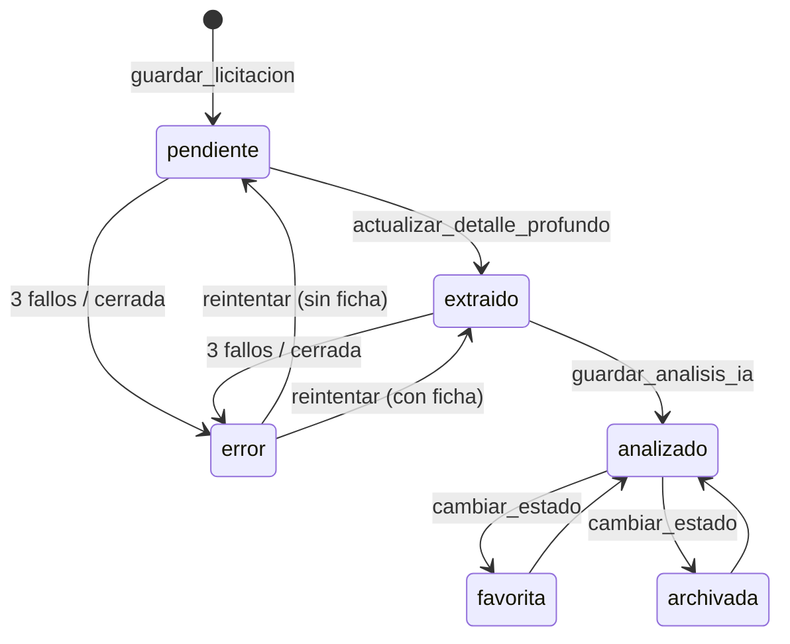

# LicitAI: modelo de datos

Este documento describe el modelo de datos del prototipo en `main`, commit `ca854c1`. La persistencia es **SQLite** (`data/mp_database.db` por defecto, configurable con `DATABASE_PATH`) y todo el acceso pasa por el DAO `core/database_mgr.py` (`DatabaseManager`), sin ORM. El flujo que escribe estos datos está en `licitai-processing-flow.md` y el cálculo del score en `licitai-scoring-model.md`.

---

## 1. Diagrama entidad-relación



`PERFIL_USUARIO` y `EJECUCIONES` no tienen relaciones con las demás tablas. El perfil se usa como contexto global, y su versión queda grabada en cada análisis como `analisis_perfil_version`. Cada ejecución es un registro independiente de una sincronización.

---

## 2. Decisiones generales

| Decisión | Motivo / efecto |
|---|---|
| **Una tabla central desnormalizada** (`licitaciones`) | Guarda en una fila los datos de la fuente, el estado del pipeline, el análisis vigente, la evaluación humana y las notas del usuario. Es simple para un prototipo de un solo usuario, a cambio de una tabla ancha |
| **Relaciones lógicas, sin `FOREIGN KEY`** | El historial y las respuestas rechazadas se vinculan por `id_externo`, pero SQLite no lo exige. No hay borrados en cascada (la aplicación tampoco borra licitaciones) |
| **Tablas de solo inserción** (`analisis_historial`, `respuestas_fallidas`, `ejecuciones`) | Permiten auditar y medir: nada se pierde al re-analizar ni al fallar |
| **Fechas como `TEXT` ISO 8601** | Se ordenan bien como texto (p. ej. la cola se ordena por `fecha_cierre`). Las fechas que escribe la aplicación usan hora local y segundos (`_ahora_iso`); `fecha_creacion` usa `CURRENT_TIMESTAMP` de SQLite (UTC) |
| **Estructuras complejas como JSON en `TEXT`** | `analisis_ia_json` y `checklist_json`. El esquema del análisis cambia con la rúbrica sin requerir migraciones |
| **Migración aditiva e idempotente** | Al iniciar, `CREATE TABLE IF NOT EXISTS` y, para `licitaciones`, `PRAGMA table_info` + `ALTER TABLE ADD COLUMN` de lo que falte (`COLUMNAS_NUEVAS`). Nunca elimina ni reescribe columnas |
| **Sin índices secundarios** | Solo existen las claves primarias. Con decenas o cientos de filas no hace falta; sería un punto a revisar si el volumen crece |
| **Conexión corta por operación** | `_get_connection` abre una conexión por llamada (`timeout=10`, `row_factory = sqlite3.Row`) y la cierra al terminar |

---

## 3. Tablas

### 3.1 `perfil_usuario`
Perfil único de la empresa (single-tenant). `CHECK (id = 1)` impide un segundo perfil, y `guardar_perfil` usa `INSERT OR REPLACE` con `id = 1`.

| Columna | Tipo | Uso |
|---|---|---|
| `id` | INTEGER PK | Siempre 1 |
| `keywords_pos` | TEXT | Keywords de inclusión, separadas por comas, punto y coma o saltos de línea. Filtran el listado por título y van al prompt |
| `keywords_neg` | TEXT | Keywords de exclusión |
| `regiones` | TEXT | Reservada; hoy no se usa en el filtrado |
| `bio_estrategica` | TEXT | Descripción de qué vende la empresa y a quién. Si está vacía, no se llama a Gemini y el resultado es `evaluacion_insuficiente` |

La **versión del perfil** no se guarda aquí. Se calcula con `parsing.version_perfil`, un SHA-1 de 8 caracteres de las keywords normalizadas y la descripción, y se graba en cada análisis.

### 3.2 `licitaciones`
Una fila por licitación descubierta; la clave es el código externo de Mercado Público. Las columnas se agrupan así:

**Identidad y datos de la fuente**
| Columna | Tipo | Origen |
|---|---|---|
| `id_externo` | TEXT PK | API (p. ej. `4776-56-LR26`) |
| `titulo` | TEXT NOT NULL | API, luego ficha. Si no viene, se guarda `Licitación <código>` como marcador |
| `organismo` | TEXT | Ficha (el listado diario normalmente no lo trae) |
| `fecha_cierre` | TEXT | API (ISO) |
| `fecha_publicacion` | TEXT | Ficha (`YYYY-MM-DD`), o NULL si no aparece |
| `region`, `reclamos_pago_n` | TEXT, INTEGER | Ficha, extraídos literalmente con expresiones regulares |
| `link` | TEXT | URL de la ficha obtenida en el portal |
| `descripcion_pro` | TEXT | Texto completo de la ficha que se envía (truncado) a la IA |
| `ficha_fecha` | TEXT | Cuándo se leyó la ficha: la fecha de los datos de la fuente |
| `fecha_creacion` | TIMESTAMP | Cuándo se registró (UTC) |

**Ciclo de vida del pipeline**
| Columna | Tipo | Uso |
|---|---|---|
| `estado` | TEXT, default `pendiente` | `pendiente` → `extraido` → `analizado`; `favorita` / `archivada` (gestión del usuario); `error` |
| `intentos` | INTEGER, default 0 | Fallos consecutivos; con `MAX_INTENTOS` (3) la licitación pasa a `error`. Se reinicia al extraer con éxito, al analizar o al reintentar |
| `ultimo_error` | TEXT | Motivo del último fallo (máximo 500 caracteres), visible en la UI |

**Análisis vigente y score**
| Columna | Tipo | Uso |
|---|---|---|
| `analisis_ia_json` | TEXT | Análisis validado completo (ver §4) |
| `score_idoneidad` | INTEGER | 0–100. NULL si es `no_elegible` o `evaluacion_insuficiente` |
| `score_estado` | TEXT | `definitivo` · `provisional` · `no_elegible` · `evaluacion_insuficiente` |
| `score_cobertura` | INTEGER | % del peso de la rúbrica que tuvo nota |
| `rubrica_version` | TEXT | `v1.1`. **NULL indica un análisis histórico** anterior a la rúbrica |
| `score_ia` | INTEGER | Solo para análisis históricos (escala 1–10). Los análisis nuevos lo dejan en NULL; nunca se convierte a 0–100 |
| `motivo_archivo` | TEXT | Por qué podría no convenir, según la IA |
| `reclamo_pago` | TEXT | Interpretación de la IA sobre los pagos del organismo. **No verificada**; el dato de la fuente es `reclamos_pago_n` |

**Trazabilidad del análisis**
| Columna | Uso |
|---|---|
| `analisis_modelo` | Modelo de Gemini usado (NULL si no se llamó a la IA por perfil incompleto) |
| `analisis_prompt_version` | `PROMPT_VERSION` de `core/ai_analyst.py` |
| `analisis_perfil_version` | Huella del perfil usado |
| `analisis_fecha` | Momento del análisis |

**Evaluación humana** (dataset para medir la calidad del score)
| Columna | Valores |
|---|---|
| `eval_score` | `acertado` · `muy_alto` · `muy_bajo` (validado en `guardar_evaluacion`) |
| `eval_postularia` | `si` · `tal_vez` · `no` |
| `eval_comentario` | Texto libre |
| `eval_fecha` | Si es anterior a `analisis_fecha`, la UI marca la evaluación como desactualizada |

**Gestión del usuario**
| Columna | Uso |
|---|---|
| `notas` | Notas internas (no se exportan) |
| `checklist_json` | JSON con `{"bases_leidas": bool, "anexos_preparados": bool}` |

### 3.3 `analisis_historial`
Copia de cada análisis **reemplazado** por un re-análisis, junto con la evaluación humana que se hizo sobre él. Columnas: `id` (PK autoincremental), `id_externo`, `reemplazado` y las columnas de `COLUMNAS_HISTORIAL`: `score_ia`, `score_idoneidad`, `score_estado`, `score_cobertura`, `rubrica_version`, `analisis_ia_json`, `motivo_archivo`, `analisis_modelo`, `analisis_prompt_version`, `analisis_fecha`, `analisis_perfil_version` y `eval_*`.

Se escribe en `guardar_analisis_ia` **en la misma transacción** que el nuevo análisis, mediante `INSERT … SELECT` desde `licitaciones`, y solo si ya había un análisis. Así, re-analizar nunca borra un análisis ni una evaluación.

### 3.4 `respuestas_fallidas`
Texto crudo de cada respuesta de Gemini que no pasó la validación: `id_externo`, `fecha`, `modelo`, `prompt_version`, `error` (máximo 500 caracteres) y `respuesta` (máximo 20 000, `MAX_RESPUESTA_FALLIDA`). Sirve para diagnosticar sin repetir la llamada y para medir la tasa de rechazo por versión del prompt. Si no se puede guardar, el análisis sigue su curso (el error solo se registra en el log).

### 3.5 `ejecuciones`
Una fila por sincronización completada (`registrar_ejecucion`): `inicio`, `fin`, `fecha_consulta`, `total_listado`, `relevantes` (= `descubiertas` del resumen), `registradas`, `analizadas`, `fallidas`, `detenido_por` y `error_descubrimiento`. Alimenta el embudo de la página Panorama. Una ejecución rechazada por el bloqueo (`PipelineEnCurso`) no se registra.

---

## 4. Contenido de `analisis_ia_json`

Es el resultado de `parsing.validar_analisis` más dos campos que agrega `AIAnalyst`:

```json
{
  "titulo_recuperado": "texto o null",
  "organismo_recuperado": "texto o null",
  "comportamiento_pago": "texto o null",
  "objeto_principal": "texto o null",
  "criterios": {
    "comercial":  {"nota": 4, "evidencia_estado": "suficiente", "evidencia": "...", "explicacion": "..."},
    "requisitos": {"nota": null, "evidencia_estado": "ausente", "evidencia": null, "explicacion": "..."},
    "capacidad":  {"...": "..."},
    "geografia":  {"...": "..."},
    "economica":  {"...": "..."}
  },
  "requisitos_obligatorios": ["..."],
  "requisitos_excluyentes": [{"requisito": "...", "estado": "no_verificable", "evidencia": null}],
  "datos_faltantes": ["..."],
  "hechos_fuente": ["..."],
  "inferencias": ["..."],
  "veredicto": "texto obligatorio",
  "puntos_criticos": ["..."],
  "riesgos": ["..."],
  "motivo_archivo": "texto o null",
  "advertencias": ["correcciones aplicadas por la validación o la rúbrica"],
  "rubrica": {
    "version": "v1.1", "estado": "provisional", "score": 75, "etiqueta": "Buena oportunidad",
    "cobertura": 75, "pendientes": ["Requisitos obligatorios"], "incumplidos": [],
    "motivo": "Score provisional: ...", "advertencias": ["..."]
  },
  "corpus_truncado": false
}
```

(Valores ilustrativos.) Las columnas `score_idoneidad`, `score_estado`, `score_cobertura` y `rubrica_version` duplican `rubrica.score`, `rubrica.estado`, `rubrica.cobertura` y `rubrica.version` para poder ordenar y filtrar con SQL sin abrir el JSON.

Al leerlo para la UI (`parsing.cargar_analisis_guardado`), la lectura es tolerante: un JSON corrupto devuelve `None`, las listas guardadas como texto se convierten en listas y las estructuras de la rúbrica ausentes en análisis históricos se rellenan vacías.

---

## 5. Quién escribe cada dato

| Operación (`DatabaseManager`) | Llamada desde | Columnas / tablas |
|---|---|---|
| `guardar_perfil` | Página Perfil | `perfil_usuario` |
| `guardar_licitacion` (`INSERT OR IGNORE`) | Fase 1 del pipeline | `id_externo`, `titulo`, `organismo`, `fecha_cierre`, `fecha_publicacion` |
| `actualizar_datos_maestros` | Tras la extracción | Datos de la ficha; ignora valores vacíos y marcadores |
| `actualizar_detalle_profundo` | Tras la extracción | `link`, `descripcion_pro`, `ficha_fecha`, `estado = 'extraido'`, `intentos = 0` |
| `registrar_fallo` / `marcar_error` / `reintentar` | Pipeline y página En proceso | `intentos`, `ultimo_error`, `estado` |
| `guardar_analisis_ia` | `AIAnalyst` | Historial + análisis, score, trazabilidad, `estado` (favorita/archivada se conservan) |
| `reparar_datos_licitacion` | `AIAnalyst` | Rellena `titulo` y `organismo` solo si son marcadores; guarda `reclamo_pago` |
| `registrar_respuesta_fallida` | `AIAnalyst` | `respuestas_fallidas` |
| `guardar_evaluacion` | Formulario de evaluación | `eval_*` |
| `cambiar_estado` | Botones Favorita / Archivar / Restaurar | `estado` |
| `guardar_notas` | Favoritas | `notas`, `checklist_json` |
| `registrar_ejecucion` | Fin de la sincronización | `ejecuciones` |

**Regla de prioridad de la fuente:** los datos leídos de Mercado Público (API y ficha) prevalecen. La IA solo completa huecos, y ningún dato real se sobrescribe con un marcador como «Sin título», «No detectado» o `None` (`parsing.es_valor_util`).

---

## 6. Ciclo de vida de una fila



Nunca se borra una fila de `licitaciones`: las descartadas se archivan y las fallidas quedan en `error` con su motivo.

---

## 7. Mantenimiento

- **Migración de esquema:** automática al instanciar `DatabaseManager`.
- **Corrección de datos antiguos:** `python -m core.migrar_datos` muestra los cambios en modo simulación; con `--aplicar` crea antes un respaldo (`<bd>.backup-AAAAMMDD-HHMMSS.db`, con la API de backup de SQLite). Recalcula `fecha_publicacion`, `region`, `reclamos_pago_n` y los títulos u organismos vacíos a partir del texto de la ficha ya guardado, sin scraping ni IA, y no toca los análisis.
- **Exportación:** `core/exportar.py` genera CSV/JSON con un formato propio, independiente del esquema. No incluye las notas internas; el texto de la ficha es opcional y solo va en el JSON.
- Los archivos `*.db` están ignorados por git.

---

## 8. Limitaciones

- Sin claves foráneas ni índices secundarios: la integridad referencial depende del código.
- Un solo perfil: el modelo no admite varias empresas ni usuarios.
- `licitaciones` mezcla datos de la fuente, del pipeline, de la IA y del usuario. Para una versión multiusuario convendría separar al menos el análisis, la evaluación y la gestión en tablas propias.
- SQLite en un archivo local no está pensado para escrituras concurrentes desde varios procesos; el pipeline lo evita con un archivo `.lock`.
- `regiones` existe en el esquema pero no se usa.
