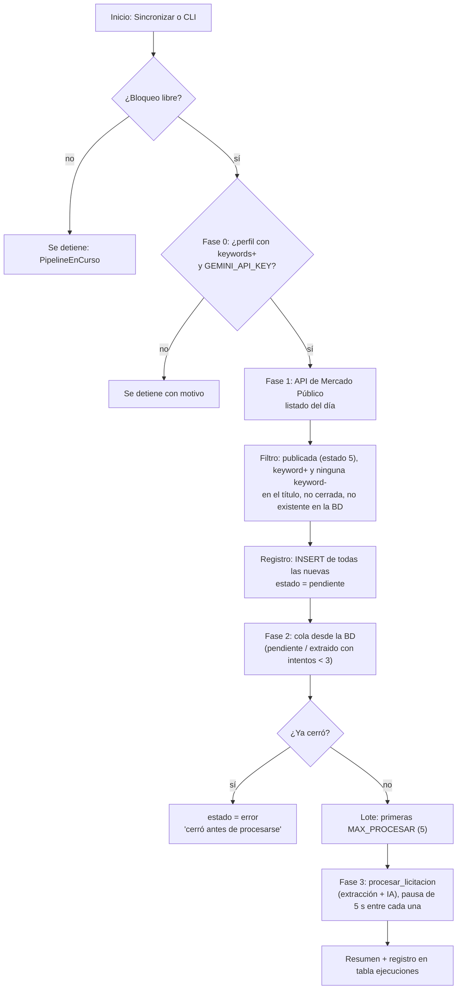
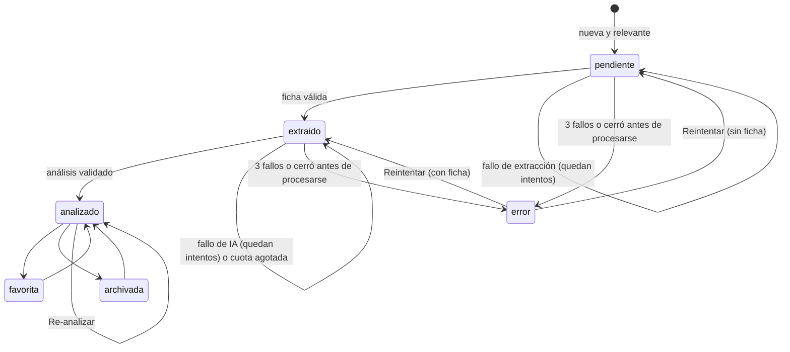

# LicitAI: flujo de procesamiento de una licitación

Este documento describe cómo una licitación pasa desde el listado diario de Mercado Público hasta un análisis con score. Refleja el código de `main` en el commit `ca854c1`. El score se explica en `licitai-scoring-model.md` y la arquitectura en `licitai-current-architecture.md`.

---

## 1. Puntos de entrada

| Entrada | Dónde | Qué hace |
|---|---|---|
| Botón «Sincronizar» (UI) o `python main.py [--fecha DDMMAAAA] [--max N]` | `main.ejecutar_pipeline` | Ciclo completo: descubrimiento, registro y procesamiento de la cola |
| Botón «Analizar ahora» (página En proceso) | `main.analizar_ahora` | Procesa una sola licitación de la cola de inmediato |
| Re-analizar (una o en lote, p. ej. tras cambiar el perfil) | `main.reanalizar_lote` | Vuelve a llamar a la IA sobre licitaciones ya analizadas |

Las tres rutas toman el mismo **bloqueo de archivo** (`<bd>.lock`, creado con `O_CREAT | O_EXCL`). Si hay otra ejecución activa, la nueva se rechaza con `PipelineEnCurso`. Un bloqueo con más de 120 minutos (`LICITAI_BLOQUEO_MAX_MINUTOS`) se considera huérfano y se reemplaza. Así se evita duplicar llamadas a Gemini desde dos pestañas, o desde la UI y una tarea programada a la vez.

La sincronización y «Analizar ahora» usan la misma función, `procesar_licitacion`. Por eso siguen exactamente las mismas reglas de fallos y reintentos.

---

## 2. Vista general



---

## 3. Fase 0: validación de configuración

Antes de llamar a cualquier servicio externo, `_ejecutar` comprueba:

1. Que el perfil tenga al menos una palabra clave positiva (`normalizar_keywords`). Sin ella, el pipeline se detiene.
2. Que se pueda crear `AIAnalyst`, lo que exige `GEMINI_API_KEY`. Sin ella, se detiene con el mensaje del `ValueError`.

En ambos casos el resumen queda con `detenido_por` y la UI muestra el motivo.

---

## 4. Fase 1: descubrimiento y registro

**Descubrimiento** (`LicitacionScraper.descubrir_licitaciones_del_dia`):
- `GET https://api.mercadopublico.cl/servicios/v1/publico/licitaciones.json?fecha=DDMMAAAA&ticket=…` (por defecto, la fecha de hoy), con un timeout de 30 s.
- Un error de red, un estado HTTP distinto de 200, un JSON inválido o la falta de `Listado` no detienen el pipeline: se guarda en `error_descubrimiento` y la cola existente se procesa igual. El mensaje de error no incluye la URL, para no exponer el ticket.

**Filtro** (`filtrar_licitaciones_relevantes`). Se conserva una licitación si cumple todo lo siguiente:
- `CodigoEstado == 5` (publicada).
- Su título contiene alguna keyword positiva y ninguna negativa. La comparación ignora mayúsculas y tildes, y se hace por subcadena (`parsing.coincide_keywords`).
- No ha cerrado. Una fecha de cierre desconocida se trata como abierta, para no perder oportunidades por falta de datos. Las cerradas se cuentan en `descartadas_cerradas`.
- No existe ya en la base de datos.

**Registro**: se insertan **todas** las nuevas que pasaron el filtro, con `estado = 'pendiente'` y los datos del listado (código, nombre, organismo si viene, fecha de cierre). El límite por ejecución se aplica solo al procesamiento, no al registro.

---

## 5. Fase 2: cola de procesamiento

La cola sale de la base de datos, no del listado del día. Así se retoman las licitaciones que quedaron pendientes en ejecuciones anteriores.

```sql
WHERE estado IN ('pendiente', 'extraido') AND COALESCE(intentos, 0) < :max_intentos
ORDER BY fecha_cierre IS NULL, fecha_cierre ASC, COALESCE(intentos, 0) ASC, fecha_creacion ASC, id_externo ASC
```

- **Prioridad por cierre:** primero las que cierran antes; las que no tienen fecha de cierre van al final.
- A igual cierre, primero las que fallaron menos veces, para que una respuesta problemática no bloquee a las demás.
- Las que ya cerraron se pasan a `error` con el motivo «La licitación cerró antes de poder procesarse» y no se procesan.
- Del resto se toman las primeras `MAX_PROCESAR` (5 por defecto). El límite cuenta **intentos**, no éxitos.

---

## 6. Fase 3: procesar una licitación

```mermaid
flowchart TD
    S[Licitación de la cola] --> P{"estado == pendiente?"}
    P -- no, ya extraido --> IA
    P -- sí --> SEL["Selenium: buscar el código en el portal,<br/>entrar a la ficha, esperar texto estable"]
    SEL -- Chrome no arranca --> SN["SIN_NAVEGADOR: se detiene<br/>(no consume intento)"]
    SEL -- error o texto no válido --> FE["registrar_fallo: intentos+1<br/>(3 fallos => error)"]
    SEL -- ficha válida --> META["Metadatos literales de la ficha:<br/>título, organismo, publicación, cierre,<br/>reclamos de pago, región"]
    META --> EXT["estado = extraido, intentos = 0,<br/>ficha_fecha = ahora"]
    EXT --> IA["AIAnalyst.analizar_licitacion"]
    IA -- cuota agotada --> CU["CUOTA: se detiene<br/>(no consume intento, sigue extraido)"]
    IA -- AnalisisFallido --> FI["registrar_fallo: intentos+1<br/>(3 fallos => error; el análisis anterior se conserva)"]
    IA -- válido --> OK["estado = analizado<br/>(favorita/archivada conservan su estado)"]
```



### 6.1 Extracción (Selenium)
`LicitacionScraper.extraer_detalle_licitacion`:
1. Abre `https://www.mercadopublico.cl` en Chrome headless (Selenium + webdriver-manager) y cierra la alerta del portal si aparece.
2. Busca el código en `#txtBuscar`, entra al iframe `form-iframe` y obtiene la URL de la ficha desde el atributo `onclick` del enlace.
3. Navega a la ficha y espera a que el texto deje de cambiar (`esperar_texto_estable`: tres lecturas consecutivas con la misma longitud, máximo 15 s). Si obtiene menos de 1000 caracteres, también lee los iframes internos.
4. Valida que el texto sea una ficha y no una página de error (`texto_ficha_valido`: al menos 200 caracteres y una etiqueta reconocible, como «Fecha de cierre»).
5. Extrae metadatos con expresiones regulares (`extraer_metadatos_ficha`). Un campo que no aparece queda en `None`; nunca se inventa.

El texto completo se guarda en `descripcion_pro`. Los datos de la ficha (fuente oficial) reemplazan a los del listado.

### 6.2 Análisis con IA
`AIAnalyst.analizar_licitacion`:
1. **Contexto:** carga el perfil y la licitación. Sin perfil o sin texto de ficha, lanza `AnalisisFallido`.
2. **Perfil incompleto:** si la descripción de la empresa (`bio_estrategica`) está vacía, **no se llama a Gemini**. Se registra un análisis con estado `evaluacion_insuficiente` y el dato faltante.
3. **Prompt:** incluye el perfil, los datos de la licitación y el texto de la ficha, truncado a 40 000 caracteres (`IA_MAX_CHARS`) y delimitado entre `<<<CORPUS>>>…<<<FIN_CORPUS>>>` con la instrucción de ignorar órdenes dentro de él. Le siguen la rúbrica con sus reglas y el formato de salida.
4. **Llamada a Gemini** con salida estructurada (`response_mime_type` JSON + `response_schema`) y `temperature = 0`. `ResourceExhausted` se convierte en `CuotaAgotada`; cualquier otro error, en `AnalisisFallido`.
5. **Parseo y validación** (`parsear_respuesta_ia` + `validar_analisis`). Si la respuesta no es válida, el texto crudo se guarda en `respuestas_fallidas` (con modelo y versión del prompt) y se lanza `AnalisisFallido`. Detalle en `structured-analysis-excerpt.txt`.
6. **Score:** `rubrica.calcular` obtiene el total, el estado y la cobertura a partir de las notas validadas. El modelo nunca entrega el total.
7. **Persistencia** (`guardar_analisis_ia`), en una sola transacción: el análisis vigente se copia a `analisis_historial` y luego se escriben el JSON, las columnas del score y la trazabilidad (modelo, versión del prompt, versión del perfil, versión de la rúbrica y fecha). Los intentos se reinician.
8. **Completar huecos** (`reparar_datos_licitacion`): la IA solo rellena el título o el organismo si están vacíos o son un marcador de posición. Nunca sobrescribe datos de la fuente.

Si cualquier paso falla antes de la persistencia, no se escribe nada. Un re-análisis fallido conserva el análisis anterior.

---

## 7. Ciclo de vida (columna `estado`)



| Situación | ¿Consume intento? | Efecto |
|---|---|---|
| Fallo de extracción o respuesta de IA inválida | Sí | `intentos + 1`; con 3 (`MAX_INTENTOS`) pasa a `error` |
| Cuota de Gemini agotada | No | Detiene la ejecución; la licitación sigue en `extraido` |
| Chrome no disponible | No | Detiene la ejecución; problema del entorno, no de la licitación |
| Extracción exitosa | — | Reinicia `intentos` para que la IA tenga sus propios reintentos |
| «Analizar ahora» sobre una en `error` | — | La devuelve a la cola con los intentos en 0 y la procesa de inmediato |

El **estado del score** (definitivo, provisional, no elegible, evaluación insuficiente) es independiente del estado de gestión. Una licitación «no elegible» sigue en Oportunidades hasta que el usuario la archive.

---

## 8. Resumen de la ejecución

`ejecutar_pipeline` devuelve un diccionario con `fecha_consulta`, `total_listado`, `descubiertas`, `registradas`, `descartadas_cerradas`, `cerradas_en_cola`, `intentadas`, `analizadas`, `fallidas`, `en_cola`, `error_descubrimiento` y `detenido_por`. Se guarda en la tabla `ejecuciones`, que alimenta el embudo de la página Panorama. `describir_resumen` lo convierte en un mensaje para el usuario con nivel `success`, `info`, `warning` o `error`.

---

## 9. Límites operativos

| Parámetro | Valor por defecto | Variable de entorno |
|---|---:|---|
| Intentos procesados por ejecución | 5 | `LICITAI_MAX_PROCESAR` |
| Fallos tolerados antes de `error` | 3 | `LICITAI_MAX_INTENTOS` |
| Pausa entre licitaciones | 5 s | `LICITAI_PAUSA_SEGUNDOS` |
| Caracteres de la ficha enviados a Gemini | 40 000 | `LICITAI_IA_MAX_CHARS` |
| Espera máxima a que el texto de la ficha se estabilice | 15 s | `LICITAI_ESPERA_TEXTO` |
| Timeout HTTP / carga de página | 30 s / 60 s | `LICITAI_HTTP_TIMEOUT` / `LICITAI_PAGE_TIMEOUT` |

Observado el 21/10/2026: el free tier de Gemini usado en el prototipo permitió 20 solicitudes diarias por modelo. Con el límite de 5 por sincronización, eso da para unas cuatro sincronizaciones al día.

---

## 10. Limitaciones del flujo

- El filtro inicial es por subcadena en el **título**: no lee la descripción ni las bases, así que puede dejar pasar falsos positivos y perder licitaciones relevantes con títulos genéricos.
- Solo se lee el texto visible de la ficha. Las bases en PDF (requisitos, multas, garantías) no se procesan.
- La extracción depende de los IDs y la estructura HTML del portal (`txtBuscar`, `btnBuscar`, `form-iframe`): un cambio del portal la rompería.
- La ejecución es secuencial y local (un proceso Python con SQLite). No hay planificador incluido: la sincronización es manual o se agenda por fuera (p. ej. con el Programador de tareas de Windows).
