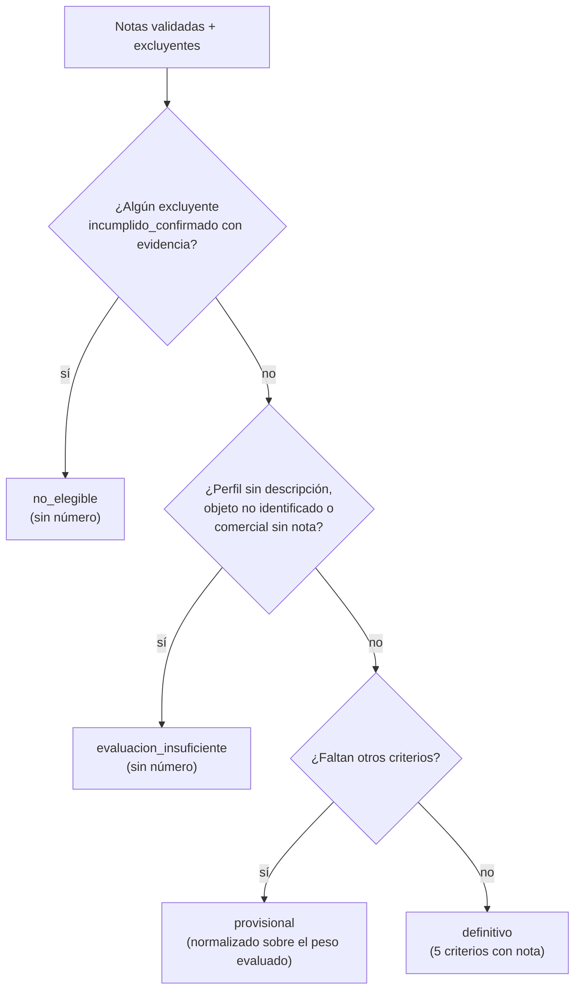

# LicitAI: modelo de scoring

Este documento describe cómo se calcula el **score de idoneidad** (rúbrica `v1.1`, prompt `2026-10-21.3`) en el commit `ca854c1`. La especificación original está en `licitai-scoring-rubrica-v1.md`, la implementación en `core/rubrica.py` y el código relevante en `scoring-excerpt.txt`.

> **Qué mide:** compatibilidad de una licitación con el perfil de la empresa. **No** es la probabilidad de ganarla. Los pesos y los rangos son una hipótesis inicial de negocio y aún no se han validado con evaluaciones humanas reales.

---

## 1. Principios

1. **El LLM evalúa, Python calcula.** Gemini entrega una nota de 0 a 5 por criterio, con su evidencia. El total, la cobertura y el estado se calculan en `rubrica.calcular`, una función pura y determinista.
2. **Evidencia antes que nota.** Un 5 exige evidencia suficiente: no basta con no haber encontrado problemas.
3. **La falta de datos no es compatibilidad ni incompatibilidad.** Un criterio sin información queda con nota `null` y no se inventa.
4. **Los requisitos excluyentes prevalecen.** Un incumplimiento confirmado no se compensa con otros puntos.
5. **La urgencia y el riesgo de pago van aparte.** El prompt prohíbe considerar la fecha de cierre o el comportamiento de pago del organismo en las notas.
6. **Todo se versiona.** Cada análisis guarda la versión de la rúbrica, del prompt y del perfil. Los análisis antiguos no se recalculan en silencio.

---

## 2. Criterios y pesos

| Clave | Criterio | Peso | Esencial | Bloqueante | Qué evalúa (texto del prompt) |
|---|---|---:|:---:|:---:|---|
| `comercial` | Compatibilidad comercial | 35 | Sí | **Sí** | Correspondencia entre el objeto de la licitación y los productos o servicios de la empresa |
| `requisitos` | Requisitos obligatorios | 25 | Sí | No | Requisitos técnicos y legales, certificaciones, experiencia y otras condiciones obligatorias |
| `capacidad` | Capacidad de cumplimiento | 20 | No | No | Volumen, cantidades, especificaciones, plazos y condiciones operativas |
| `geografia` | Viabilidad geográfica y logística | 10 | No | No | Capacidad de entregar o prestar el servicio en la ubicación requerida |
| `economica` | Viabilidad económica y contractual | 10 | No | No | Presupuesto, costos y condiciones contractuales disponibles |

- **Bloqueante:** sin su nota no hay evaluación posible (`evaluacion_insuficiente`).
- **Esencial:** si falta, se agrega una advertencia («Requisitos obligatorios no verificados en la ficha: revisa las bases de la licitación»).

### Escala de notas (entero 0–5 o `null`)
| Nota | Significado |
|---:|---|
| 0 | Incompatible o incumplimiento demostrado |
| 1 | Compatibilidad muy baja |
| 2 | Compatibilidad parcial, con brechas importantes |
| 3 | Compatibilidad razonable, con condiciones pendientes |
| 4 | Buena compatibilidad, con brechas menores |
| 5 | Compatibilidad completa, respaldada por evidencia suficiente |

Cada criterio trae además `evidencia_estado` (`suficiente` | `parcial` | `ausente`), la evidencia citada y una explicación breve.

### Reglas específicas del prompt
- **Geografía:** compara el lugar de entrega con dónde opera la empresa **según el perfil**. Si el perfil no lo indica, la nota es `null`. Esta regla se añadió porque Gemini asignaba 5 con evidencia «suficiente» sin ese dato.
- **Capacidad:** si el perfil no describe volúmenes, plazos o cobertura, la evidencia es a lo más «parcial».
- **Requisito excluyente:** es `incumplido_confirmado` solo si la ficha y el perfil demuestran que no se cumple. Si solo falta información, es `no_verificable`.

---

## 3. Correcciones aplicadas antes del cálculo

La validación (`parsing.validar_analisis`) no cambia notas por criterio propio. Solo anula lo que no tiene respaldo, y cada corrección queda registrada en `advertencias`:

| Caso | Corrección |
|---|---|
| Nota con `evidencia_estado = "ausente"` | La nota se anula (`null`) |
| Evidencia `suficiente` o `parcial` sin nota | Se mantiene `null` y se advierte |
| Excluyente `incumplido_confirmado` sin evidencia | Pasa a `no_verificable` |
| Nota 5 sin evidencia `suficiente` | Se mantiene, pero se advierte (en `rubrica.calcular`) |
| Nota decimal, booleana, no numérica o fuera de 0–5 | La respuesta completa se rechaza |

---

## 4. Estados del resultado (por orden de prevalencia)



| Estado | Cuándo | Score |
|---|---|---|
| `no_elegible` | Algún requisito excluyente con incumplimiento **confirmado y con evidencia** | `None`, con el motivo y el requisito |
| `evaluacion_insuficiente` | El perfil no describe la empresa (en este caso no se llama a Gemini), no se identifica el objeto de la licitación o falta la nota comercial | `None`, con el motivo |
| `provisional` | Hay nota comercial y falta algún otro criterio | 0–100 normalizado; no es directamente comparable con un definitivo |
| `definitivo` | Los cinco criterios tienen nota | 0–100 |
| `historico` | Análisis previos a la rúbrica (`rubrica_version` NULL) | Escala antigua 1–10 (`score_ia`); nunca se convierte |

---

## 5. Fórmula

**Definitivo:**

```
score = Σ peso_i · nota_i / 5
      = 35·n_comercial/5 + 25·n_requisitos/5 + 20·n_capacidad/5 + 10·n_geografia/5 + 10·n_economica/5
```

Con estos pesos y notas enteras, el total definitivo siempre es entero, así que no se redondea.

**Provisional** (normalizado sobre el peso evaluado):

```
score = redondear_half_up( Σ_evaluados peso_i · nota_i / 5  ×  100 / peso_evaluado )
cobertura = redondear_half_up( 100 × peso_evaluado / PESO_TOTAL )     # PESO_TOTAL = 100
```

El redondeo es *half-up* con aritmética exacta (`fractions.Fraction`), porque `round()` de Python usa redondeo bancario (`round(82.5) == 82`).

### Ejemplos
| Notas (com, req, cap, geo, eco) | Cálculo | Resultado |
|---|---|---|
| 5, 4, 4, 3, 3 | 35 + 20 + 16 + 6 + 6 | **83**, definitivo, «Buena oportunidad» |
| 4, `null`, 4, 3, 3 | (28 + 16 + 6 + 6) = 56 sobre 75 de peso → 74,67 | **75**, provisional, cobertura 75 %, aviso «revisar bases» |
| `null`, 5, 5, 5, 5 | Falta el criterio bloqueante | `evaluacion_insuficiente` |
| cualquier nota + excluyente confirmado | Prevalece el excluyente | `no_elegible` |

En la especificación, el primer ejemplo aparece como 84, pero su propia fórmula da 83. La implementación sigue la fórmula; el autor decidió no editar la especificación.

---

## 6. Interpretación y visualización

| Rango | Etiqueta | Nivel visual |
|---|---|---|
| 90–100 | Idoneidad excelente | alto (verde) |
| 75–89 | Buena oportunidad | alto (verde) |
| 60–74 | Oportunidad potencial | medio (amarillo) |
| 40–59 | Encaje limitado | medio (amarillo) |
| 0–39 | Baja idoneidad | bajo (rojo) |

- Bajo 40 (`UMBRAL_DESCARTE`), o en estado `no_elegible`, se muestra el motivo por el que podría no convenir (`motivo_archivo`).
- Texto corto: `83/100`, `75/100 (provisional)`, `No elegible`, `Evaluación incompleta`, `7/10 (rúbrica anterior)`.
- La UI muestra también la cobertura, el desglose por criterio con su evidencia y las advertencias de corrección.

---

## 7. Persistencia y trazabilidad

| Columna (`licitaciones`) | Contenido |
|---|---|
| `score_idoneidad` | 0–100, o NULL si es no elegible o la evaluación es insuficiente |
| `score_estado` | `definitivo` · `provisional` · `no_elegible` · `evaluacion_insuficiente` |
| `score_cobertura` | % del peso de la rúbrica con nota |
| `rubrica_version` | `v1.1`; NULL indica un análisis histórico |
| `analisis_ia_json` | Respuesta validada completa + resultado de la rúbrica (`rubrica`) + `corpus_truncado` |
| `analisis_modelo`, `analisis_prompt_version`, `analisis_perfil_version`, `analisis_fecha` | Con qué y cuándo se generó |
| `score_ia` | Solo para análisis históricos (1–10) |

Cada re-análisis copia el anterior, con su evaluación humana, a `analisis_historial`.

---

## 8. Historial de versiones

| Versión | Cambio |
|---|---|
| Escala 1–10 (histórica) | El modelo entregaba directamente un score entero |
| `v1` | Rúbrica de 5 criterios con notas 0–5 y total calculado en Python. Los dos criterios esenciales eran bloqueantes |
| `v1.1` | Solo la compatibilidad comercial es bloqueante. Si faltan los requisitos obligatorios, el score queda provisional con el aviso «revisar bases». Motivo: los requisitos suelen estar en las bases PDF, que el prototipo no lee, y la v1 dejaba sin score casos útiles (p. ej. `4776-56-LR26`, encaje comercial 1/5 con evidencia suficiente) |

---

## 9. Estado de validación y limitaciones

- **Precisión no medida con usuarios reales.** Hay 1 evaluación humana del autor; las otras 14 fueron simuladas con Claude actuando como un gerente ficticio y no cuentan como evidencia.
- **Distribución sesgada hacia valores altos** (15 análisis v1.1: 14 definitivos, mediana ≈ 82). Se explica en parte por el sesgo del filtro por keywords y en parte, posiblemente, por sobreestimación del modelo.
- **El modelo no conoce las marcas de la empresa:** licitaciones atadas a un sistema cerrado de otra marca recibieron entre 58 y 79 (observación sobre datos simulados).
- **Licitaciones con muchos ítems** pueden recibir un encaje comercial alto aunque la empresa cubra solo una parte.
- Los pesos (35/25/20/10/10) y los umbrales (90/75/60/40) son hipótesis iniciales, sin calibrar.
- `temperature = 0` reduce, pero no elimina, la variación entre ejecuciones sobre la misma ficha.

Pendiente: validar con más análisis reales y evaluaciones humanas (meta para publicar: ≥ 30–50, con ≥ 8–10 por tramo), siempre informando `n`.
